# Первое подключение в DBeaver

Проверено в Windows 11: DBeaver 26.2.3, MariaDB 10.4.32, Connector/J 3.5.6. Это настройка рабочего места перед созданием таблиц. Пароль СУБД выдаёт преподаватель; он не является паролем покупателя приложения.

1. Нажмите Ctrl+Shift+N → MariaDB → Next. Укажите сервер, фактический порт и пользователя СУБД. В проверенной VM порт 3307; в вашей среде он может отличаться. Имя базы пока можно оставить пустым, включив Show all databases.
2. Нажмите Test Connection. При первом запуске появится Download driver files. Нажмите Download и дождитесь результата.
3. В проверенной VM загрузка `org.mariadb.jdbc:mariadb-java-client:RELEASE` не разрешилась. Если возникла такая же ошибка, выберите Abort и Edit Driver. Перейдите на вкладку Libraries.
4. Выделите неразрешённую Maven-запись в списке библиотек, нажмите Delete и подтвердите удаление записи из списка библиотек. Само подключение и базы здесь не удаляются.
5. Скачайте [mariadb-java-client-3.5.6.jar из Maven Central](https://repo.maven.apache.org/maven2/org/mariadb/jdbc/mariadb-java-client/3.5.6/mariadb-java-client-3.5.6.jar) в постоянную папку инструментов. Через Add File выберите этот JAR. Нажмите Find Class, выберите `org.mariadb.jdbc.Driver`, закройте список и нажмите OK.
6. Повторите Test Connection. Должно появиться Connected с сервером и версией драйвера, как на снимке. Затем OK → Finish.
7. Если слева открыт Files, откройте Connections значком базы в левой вертикальной панели. Разверните созданное подключение.

SHA-256 проверенного JAR: `a129703efd7b0f334564d46753de999f09b3a361489a2eb647e6020390981cc9`. Сам JAR не включён в репозиторий; ссылка ведёт на конкретную версию. Назначение и варианты установки описаны в [официальном руководстве Connector/J](https://mariadb.com/docs/connectors/mariadb-connector-j/about-mariadb-connector-j).

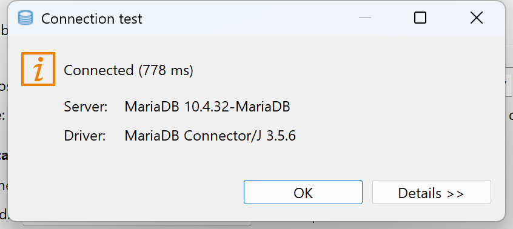

JDBC нужен DBeaver. Пакет MySqlConnector из NuGet нужен проекту C# — он не заменяет JDBC-драйвер редактора БД.

## Создайте свою базу

1. Правый клик по подключению → Create → Database.
2. Введите свободное имя своей учебной базы. В проверке использовано `prog_demo_student_20261105`.
3. Выберите Charset `utf8mb4`, Collation `utf8mb4_unicode_ci` → OK.
4. Разверните Databases и найдите созданную базу. Все дальнейшие действия выполняйте внутри неё.

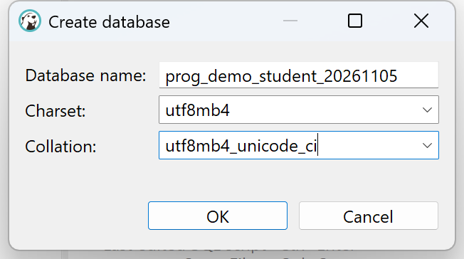

## Создайте первую таблицу

1. В собственной базе: правый клик по Tables → Create New Table. В Properties задайте Table Name `roles`; Engine — InnoDB. Кодировки наследуются от базы.
2. В пустом списке Columns: правый клик → Create New Column (Alt+Insert).
3. Введите Name `id`, Data Type `int`, отметьте Not Null. В Keys включите Unique, выберите Type **Primary Key**. Имя ограничения можно оставить `roles_pk`. Нажмите OK.
4. Снова Create New Column: Name `name`, Data Type `varchar(80)`, Not Null. В Keys включите Unique, Type **Unique Key**. Это уникальность названия роли, а не второй первичный ключ. Нажмите OK.
5. В списке Columns проверьте оба поля. Нажмите Save (Ctrl+S): появится Persist Changes с SQL, который сформировал конструктор.
6. Проверьте имя собственной базы и таблицы, оба поля, PRIMARY KEY и UNIQUE KEY. Нажмите **Execute**. Только теперь таблица сохраняется в СУБД.

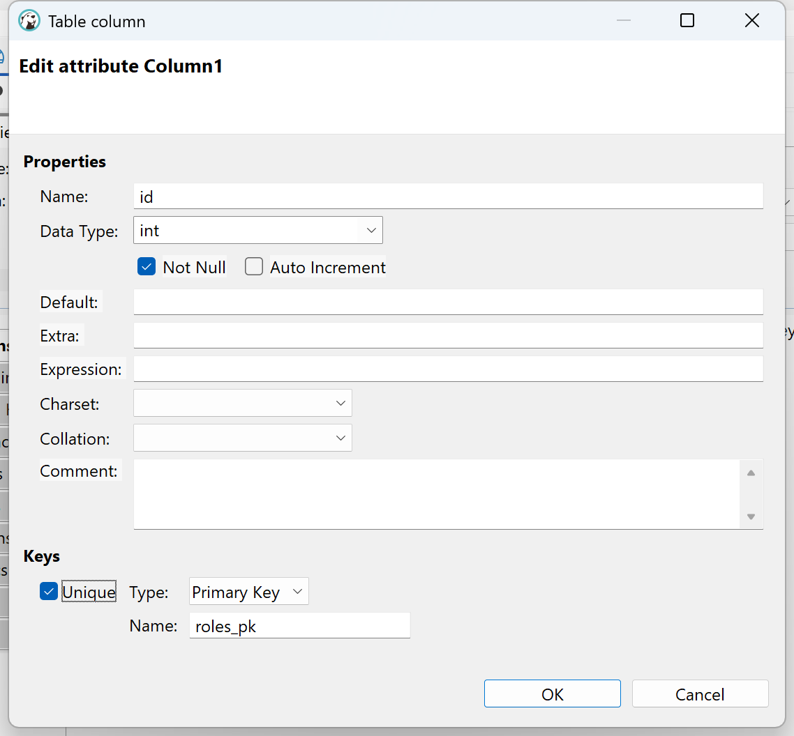

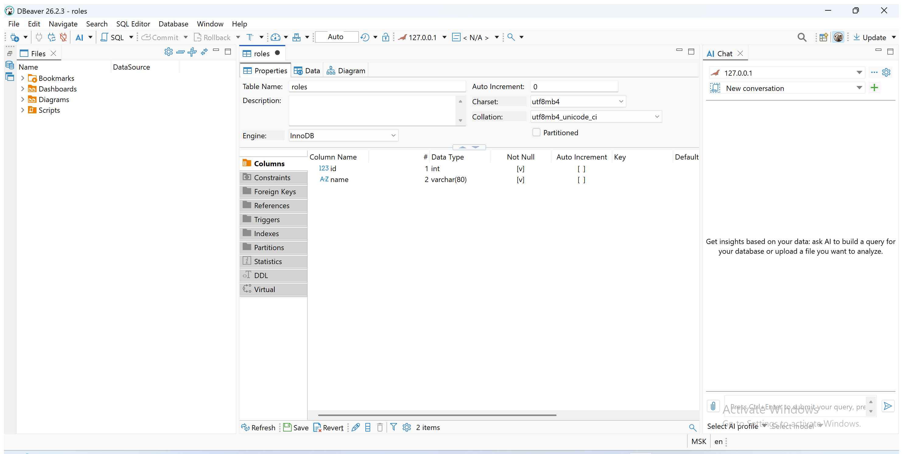

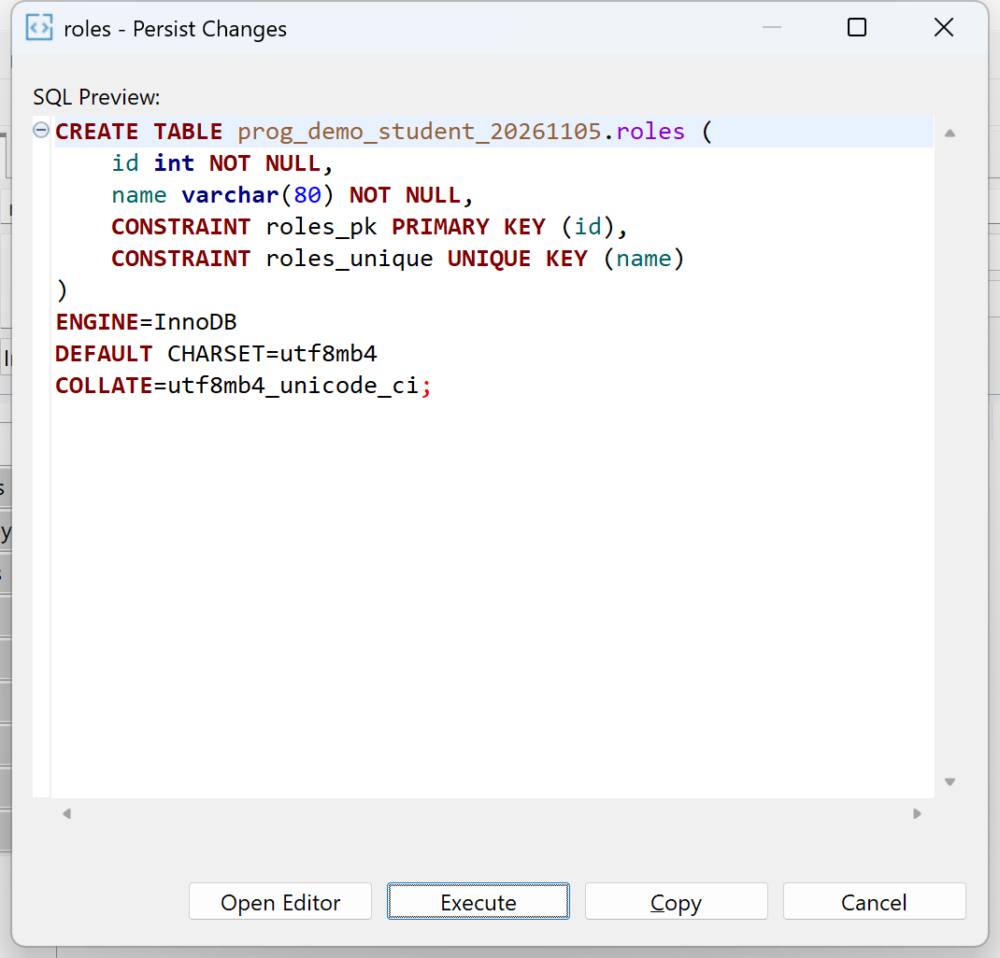

Кнопка Copy в Persist Changes копирует SQL в буфер и закрывает подтверждение; она не сохраняет таблицу. Если выбрали Copy, вернитесь к Save и Execute. Этот SQL студент не набирает вручную.

По той же схеме создайте остальные таблицы по [полному перечню 41 поля](Database-fields.md). Две особенности:

- После выбора Unique Key повторно проверьте Not Null. Переключение с Primary Key может оставить этот флажок. У `orders.request_id` он должен быть снят, хотя поле уникальное: исходные заказы не имеют идентификатора повторного запроса.
- У `users.login` нужно сравнение с учётом регистра. После сохранения таблицы дважды щёлкните поле `login` в Columns (или View Column / F4). Откроется **отдельная вкладка**, а не окно создания поля. Выберите Charset `utf8mb4`, Collation `utf8mb4_bin`, Save → проверьте сформированное изменение собственной таблицы → Execute. Вернитесь к вкладке `users`.

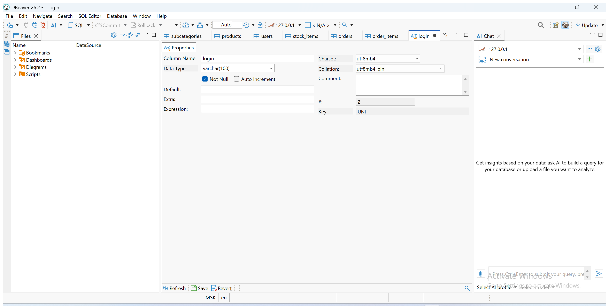

## Связи таблиц

Пример: строка заказа принадлежит одному заказу.

1. Откройте `order_items` → Properties → Foreign Keys. В пустом списке нажмите Alt+Insert.
2. В окне Constraint проверьте Table: ваша база и `order_items`. В Reference table найдите и **выделите** `orders`. Поле Database не переключайте на чужую базу.
3. Оставьте Unique Key `PRIMARY (Primary Key)`. В строке Columns нажмите на первую ячейку Column и выберите **order_id**. Ref Column должен быть **id**. Не оставляйте автоматически выбранный `id` слева: он относится к другой сущности.
4. Для этой связи On Delete — **Cascade**, On Update — No Action. Остальные связи ниже используют No Action в обоих списках.
5. OK → Save → проверьте таблицы, поля и действие удаления в сформированном запросе → Execute.

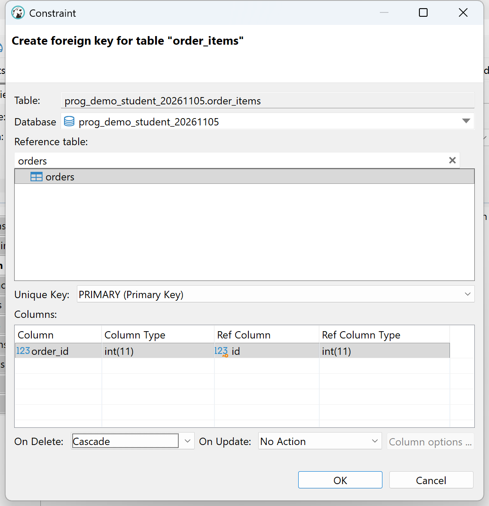

Повторите для всех десяти связей. Слева — внешний ключ, справа — существующий первичный ключ:

| Таблица и поле | Ссылается на | On Delete |
| --- | --- | --- |
| users.role_id | roles.id | No Action |
| subcategories.category_id | categories.id | No Action |
| products.subcategory_id | subcategories.id | No Action |
| products.manufacturer_id | manufacturers.id | No Action |
| stock_items.product_id | products.id | No Action |
| stock_items.size_id | sizes.id | No Action |
| orders.user_id | users.id | No Action |
| orders.created_by | users.id | No Action |
| order_items.order_id | orders.id | Cascade |
| order_items.stock_id | stock_items.id | No Action |

## Составная уникальность

Пример: одна складская позиция в одном заказе.

1. Откройте `order_items` → Constraints → Alt+Insert.
2. Type — **UNIQUE KEY**, Name — `order_stock_uq`.
3. В Columns отметьте только `order_id` и `stock_id`. Это **одно** ограничение на пару полей, не два ограничения на каждое поле. `id` здесь не отмечайте.
4. OK → Save → проверьте `UNIQUE KEY (order_id,stock_id)` в запросе конструктора → Execute.

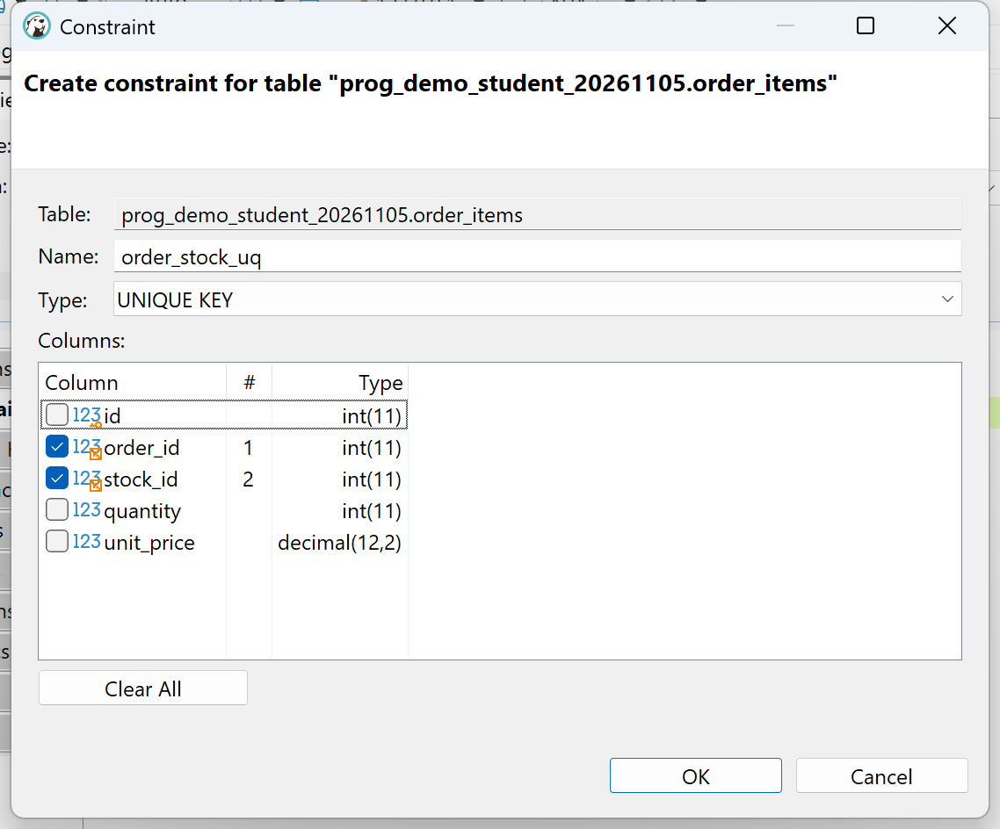

| Таблица | Имя ограничения | Поля |
| --- | --- | --- |
| subcategories | category_name_uq | category_id, name |
| products | model_manufacturer_uq | name, manufacturer_id |
| stock_items | product_size_uq | product_id, size_id |
| order_items | order_stock_uq | order_id, stock_id |

Ограничение `order_stock_uq` не запрещает две разные позиции в одном заказе и одну позицию в разных заказах.

## Проверки допустимых значений

1. В нужной таблице откройте Constraints → Alt+Insert.
2. В раскрывающемся списке Type выберите **CHECK**. Вместо Columns появится редактор Expression.
3. Задайте Name и выражение из таблицы. В Expression вводится только условие — без `ALTER TABLE`, `CHECK` и завершающей точки с запятой.
4. OK → Save → проверьте собственную таблицу и условие → Execute.

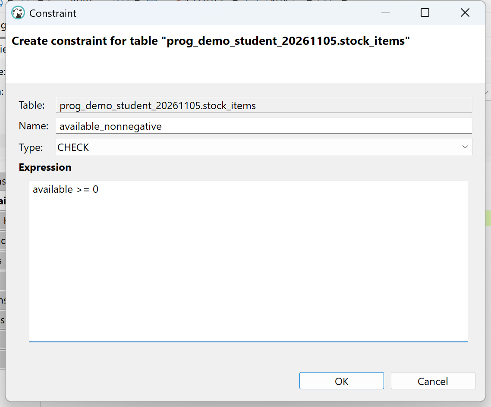

| Таблица | Name | Expression |
| --- | --- | --- |
| products | price_nonnegative | price >= 0 |
| stock_items | available_nonnegative | available >= 0 |
| order_items | quantity_positive | quantity > 0 |
| order_items | unit_price_nonnegative | unit_price >= 0 |

Первичный ключ в таблице остаётся один. Если в списке появилась лишняя несохранённая запись или предпросмотр отличается от ожидаемого, нажмите Cancel, затем Revert и повторите настройку. Не выполняйте непонятное изменение структуры.

## Индекс даты заказа

Откройте `orders` → Indexes → Alt+Insert. Оставьте Type **BTree**, флажок **Unique не включайте**, отметьте только `order_date`. OK → Save → проверьте собственную таблицу и поле → Execute. Конструктор присвоил имя `orders_order_date_IDX`. Это обычный индекс для сортировки и отбора по дате; заказы с одинаковой датой допустимы.

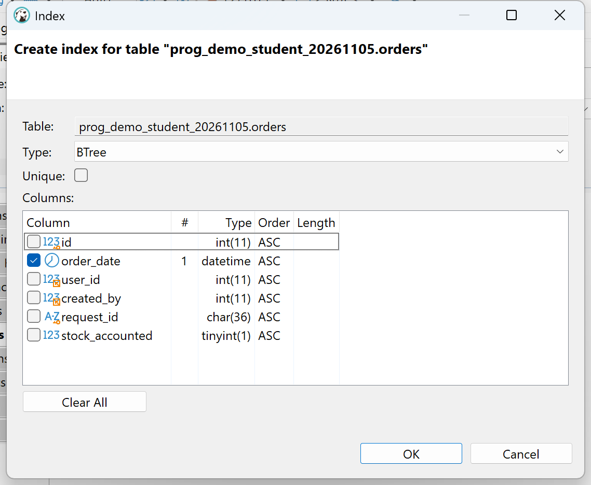

Состав полей и ограничений проверен чтением структуры реального сервера: 10 таблиц, 41 поле, 10 PK, 10 UNIQUE, 10 FK и 4 CHECK. Импорт данных и ER описаны далее; экспорт SQL и восстановление проверяются отдельно.

## Загрузите подготовленные данные

Перед этим все таблицы должны быть пустыми. Импортёр C# описан в [маршруте конструкторов](Designer-route.md#импорт-без-изменения-структуры): укажите ему имя именно своей созданной базы. Исходные XLSX не исправляйте.

1. В DBeaver нажмите Ctrl+O и откройте полученный `data.sql`.
2. У открытого файла сначала может стоять `<none>`. В верхнем списке активного подключения (`<N/A>`) выберите своё подключение MariaDB. Одного открытия файла недостаточно для выполнения.
3. Проверьте первую строку `USE`: это ваша учебная база. Далее идут START TRANSACTION, INSERT и в конце COMMIT. Создания таблиц в этом файле нет.
4. Выполните **SQL Editor → Execute SQL Script (Alt+X)**. Ctrl+Enter выполняет только текущее выражение и для импорта всего файла не подходит.
5. В диалоге Preparing to execute the script можно выбрать **Yes**: это отключает получение отдельного результата каждого INSERT, а не пропускает команды.
6. Дождитесь окончания выполнения. При ошибке не выбирайте пропуск ошибки и не запускайте файл повторно поверх частично загруженных данных. Прервите выполнение, выполните ROLLBACK в том же подключении и разберите причину.
7. Проверьте количества запросами SELECT COUNT(*). Для исходного задания должны получиться значения ниже. В авторских тренировочных вариантах количества могут отличаться.

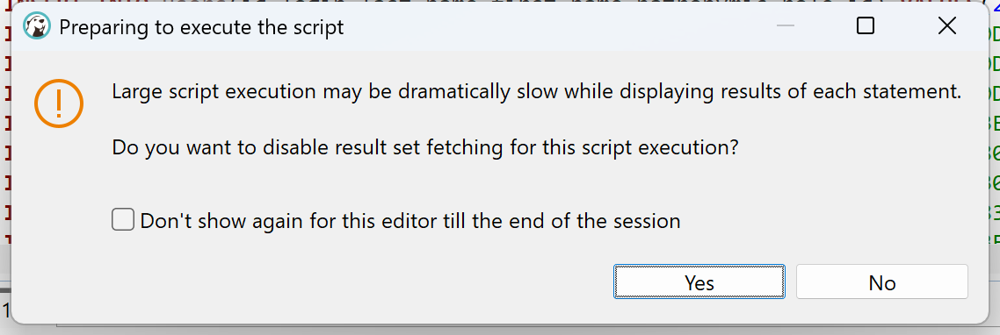

| Таблица | Записей в исходном задании |
| --- | --- |
| roles | 3 |
| users | 20 |
| categories | 3 |
| subcategories | 11 |
| manufacturers | 16 |
| products | 31 |
| sizes | 35 |
| stock_items | 92 |
| orders | 10 |
| order_items | 30 |

Загрузка в созданную конструктором базу проверена. Количества получены отдельным подключением после фиксации транзакции; [метаданные и результат проверки](audit/database-designer.json). Экспорт и восстановление ещё проверяются.

## Сохраните ER-диаграмму

1. В Database Navigator дважды щёлкните свою базу и откройте вкладку **Diagram**. Ctrl+M разворачивает редактор внутри DBeaver.
2. Откройте **Settings** (шестерёнка под диаграммой). Включите **Data Types** и **Nullability**, выберите **Notation → Crow’s Foot**, затем Apply and Close. На схеме появятся типы, обязательность полей и кратности.
3. Нажмите **Arrange Diagram**. После включения типов ширина таблиц увеличивается: прежнее расположение может перекрывать соседние таблицы. Автоматическое размещение устраняет это. При необходимости передвиньте таблицы за заголовки.
4. Проверьте все 10 таблиц, обе связи orders с users и остальные линии. Для request_id отсутствие NOT NULL ожидаемо.
5. Нажмите Save, чтобы сохранить расположение. Через **Save diagram as…** сохраните PNG в папку сдачи. На вопрос Open exported file можно ответить No.
6. Откройте полученный PNG: проверьте читаемость имён и типов, отсутствие обрезанных таблиц и перекрытий.

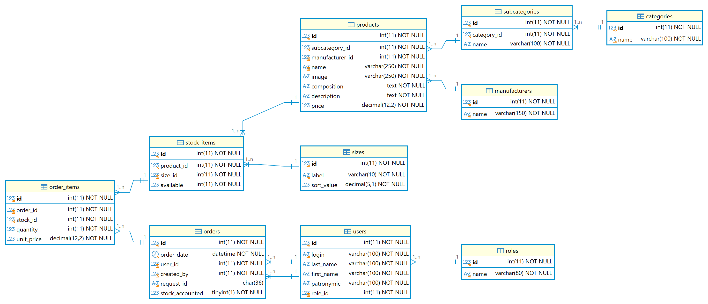

Показан подлинный экспорт DBeaver после настройки и автоматического размещения. Печать ER в PDF и полный цикл экспорта SQL с восстановлением ещё проверяются.
