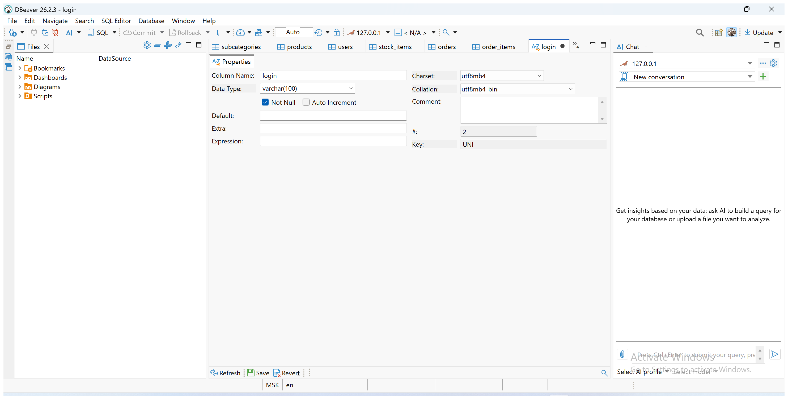

# Свойства полей для конструктора БД

Задайте эти значения в редакторе Columns. NULL=NO означает Not Null; PK — первичный ключ, FK — внешний ключ. SQL для сдачи получают экспортом созданной базы. Эти 41 поле и ограничения созданы в DBeaver 26.2.3 и сверены с MariaDB 10.4.32. [Пошаговая настройка и снимки](DBeaver.md). Импорт и восстановление экспорта проверяются отдельно.

## roles

В столбце NULL значение NO означает включённый флажок Not Null. FK показывает будущую связь. Добавьте внешние ключи после создания всех таблиц. У идентификаторов оставляйте Auto Increment выключенным, кроме orders.id и order_items.id.

| Field | Data Type | NULL | Key |
| --- | --- | --- | --- |
| id | INT | NO | PK |
| name | VARCHAR(80) | NO |  |

У поля `name` выберите Unique Key.

## users

| Field | Data Type | NULL | Key |
| --- | --- | --- | --- |
| id | INT | NO | PK |
| login | VARCHAR(100) | NO |  |
| last_name | VARCHAR(100) | NO |  |
| first_name | VARCHAR(100) | NO |  |
| patronymic | VARCHAR(100) | NO |  |
| role_id | INT | NO | FK: roles.id |

У поля `login` выберите Unique Key. У `users.login` нужно сравнение с учётом регистра. После сохранения таблицы дважды щёлкните поле `login` в Columns (или View Column / F4). Откроется **отдельная вкладка**, а не окно создания поля. Выберите Charset `utf8mb4`, Collation `utf8mb4_bin`, Save → проверьте сформированное изменение собственной таблицы → Execute. Вернитесь к вкладке `users`.

## categories

| Field | Data Type | NULL | Key |
| --- | --- | --- | --- |
| id | INT | NO | PK |
| name | VARCHAR(100) | NO |  |

У поля `name` выберите Unique Key.

## subcategories

| Field | Data Type | NULL | Key |
| --- | --- | --- | --- |
| id | INT | NO | PK |
| category_id | INT | NO | FK: categories.id |
| name | VARCHAR(100) | NO |  |

## manufacturers

| Field | Data Type | NULL | Key |
| --- | --- | --- | --- |
| id | INT | NO | PK |
| name | VARCHAR(150) | NO |  |

У поля `name` выберите Unique Key.

## products

| Field | Data Type | NULL | Key |
| --- | --- | --- | --- |
| id | INT | NO | PK |
| subcategory_id | INT | NO | FK: subcategories.id |
| manufacturer_id | INT | NO | FK: manufacturers.id |
| name | VARCHAR(250) | NO |  |
| image | VARCHAR(250) | NO |  |
| composition | TEXT | NO |  |
| description | TEXT | NO |  |
| price | DECIMAL(12,2) | NO |  |

## sizes

| Field | Data Type | NULL | Key |
| --- | --- | --- | --- |
| id | INT | NO | PK |
| label | VARCHAR(10) | NO |  |
| sort_value | DECIMAL(5,1) | NO |  |

У поля `label` выберите Unique Key. Тип DECIMAL(5,1) сохраняет дробные размеры.

## stock_items

| Field | Data Type | NULL | Key |
| --- | --- | --- | --- |
| id | INT | NO | PK |
| product_id | INT | NO | FK: products.id |
| size_id | INT | NO | FK: sizes.id |
| available | INT | NO |  |

## orders

| Field | Data Type | NULL | Key |
| --- | --- | --- | --- |
| id | INT | NO | PK |
| order_date | DATETIME | NO |  |
| user_id | INT | NO | FK: users.id |
| created_by | INT | NO | FK: users.id |
| request_id | CHAR(36) | YES |  |
| stock_accounted | BOOLEAN | NO |  |

У `id` включите Auto Increment. У `stock_accounted` задайте Default 1. У `request_id` выберите Unique Key. После выбора Unique Key повторно проверьте Not Null. У `orders.request_id` флажок должен быть снят, хотя поле уникальное: исходные заказы не имеют идентификатора повторного запроса. В SQL Preview у строки `request_id char(36)` не должно быть `NOT NULL`. Если редактор сохранил этот атрибут, до импорта откройте поле `request_id` через View Column (F4), снимите **Not Null** и снова проверьте предпросмотр перед Execute.

## order_items

| Field | Data Type | NULL | Key |
| --- | --- | --- | --- |
| id | INT | NO | PK |
| order_id | INT | NO | FK: orders.id |
| stock_id | INT | NO | FK: stock_items.id |
| quantity | INT | NO |  |
| unit_price | DECIMAL(12,2) | NO |  |

У `id` включите Auto Increment.
