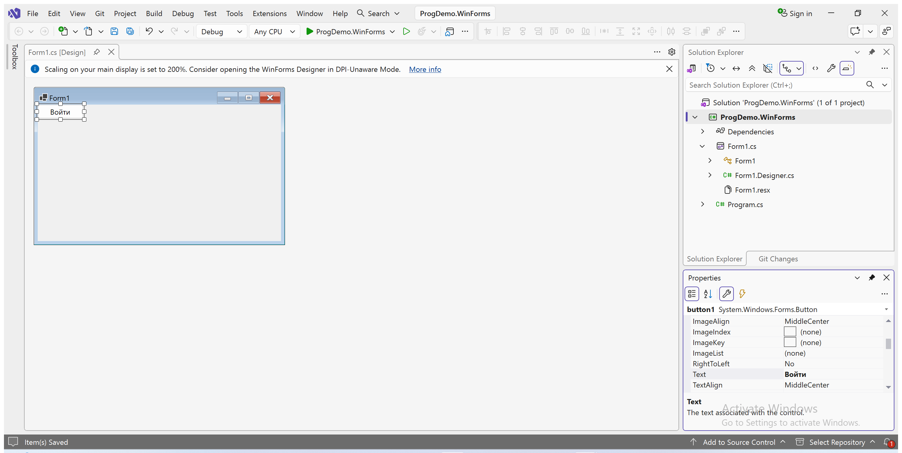

# Формы и БД через конструкторы

Основной учебный маршрут: Windows Forms Designer в Visual Studio и редакторы структуры/связей СУБД. Все семь окон текущего примера созданы в Visual Studio Designer. Таблицы, ключи и связи учебной базы созданы в редакторах DBeaver.

## Что делает студент

| Результат | Инструмент | Сохранённые файлы |
| --- | --- | --- |
| Окно и его компоненты | Add → Windows Form; Toolbox; Properties; редактор событий | `.cs`, `.Designer.cs`, `.resx` |
| Компоновка, размеры, цвета, шрифт | Properties, Dock/Anchor, TableLayoutPanel/FlowLayoutPanel | Изменения, сохранённые Designer |
| Поля и ограничения таблицы | Редактор таблицы СУБД | Структура реальной БД |
| PK, уникальные индексы и FK | Редакторы ключей/индексов/связей | Ограничения реальной БД |
| Данные XLSX | Собственный импортёр C# | `data.sql`, отчёт сопоставления |
| Диаграмма | ER реальной БД в визуальном редакторе | Экспорт изображения и PDF |
| SQL для сдачи | Export/Backup структуры и данных | SQL с CREATE/INSERT, полученный экспортом |
| Запросы, расчёты и события | Редактор C# и SQL | Прикладной код и параметризованные запросы |

Код в автоматически сохранённом `.Designer.cs` нормален: его создаёт Visual Studio. Студент не заменяет Designer ручным набором `new Button`, `Controls.Add` и координат в обработчиках. Повторяющиеся строки данных добавляются привязкой данных; фиксированные колонки таблицы настраиваются в редакторе колонок.

Подробные свойства семи форм и действия в Visual Studio: [создание окон в конструкторе](Forms-designer.md).

## Первый проверяемый цикл формы

1. Создать **Windows Forms App**, язык C#, без пометки `.NET Framework`. Сохранить исходный Form1 вместе с вложенными `.Designer.cs` и `.resx`.
2. Открыть форму: правый клик → View Designer либо Shift+F7. Открыть Toolbox: Ctrl+Alt+X.
3. Найти Button и дважды щёлкнуть элемент Toolbox: кнопка появляется на форме. Это действие проверено в Visual Studio 2026 в Windows VM.
4. Выделить компонент, F4. `(Name)` задаёт имя в коде; `Text` — видимую надпись. Изменить свойства и сохранить форму. Назначение обработчика — через вкладку событий (молния) или двойной щелчок по компоненту.
5. В обработчике написать функцию работы с объектом: прочитать ввод, вызвать запрос/правило, показать результат. Не добавлять туда построение окна.

В Windows собраны оконный проект и библиотека, все семь окон открывались в рабочем приложении. Проверены гостевой каталог, вход по логину, фильтр и сортировка, выбор размера, заказ клиента, изменение даты и удаление тестовых данных администратором. У менеджера действия изменения даты и удаления строки скрыты. Снимки и SHA-256 сохранённых Visual Studio файлов приведены в [отчёте по формам](audit/designer-forms.json).

## Импорт без изменения структуры

Новый проект `examples/Import` — консольное приложение C# .NET 10 без внешних пакетов. В Visual Studio выбрать его стартовым проектом. При запуске указать папку с пятью распакованными XLSX, папку результата и имя уже созданной учебной БД. Входные книги остаются без изменений.

Импортёр проверяет однозначность модели, связность размера/позиции/покупателя, целочисленность количества и согласованность заголовка заказа. Сокращённое название сопоставляется явным правилом. Выход — `USE`, транзакция и `INSERT`; команд создания/изменения/удаления таблиц нет. Для импорта сначала нужны все десять пустых таблиц с согласованными полями и ключами. Повтор поверх заполненной БД не выполнять.

Подготовка файла данных проверена на macOS и Windows: 31 модель, 92 позиции, 35 размеров, 20 пользователей, 10 заказов и 30 строк. Структура отдельно создана в визуальных редакторах DBeaver и проверена на сервере: [пошаговый маршрут](DBeaver.md), [41 поле](Database-fields.md), [метаданные](audit/database-designer.json). Экспорт базы нативным клиентом MariaDB восстановлен под отдельным именем. Совпали количества строк всех десяти таблиц, на восстановленной базе прошли 14 проверок. В PDF выведена диаграмма из DBeaver. [Доказательства восстановления](audit/designer-restore.json).

## Границы проверки

В проверке используется одна учебная база с исходным комплектом и Windows 11 при масштабе 200%. У учебных вариантов отдельные входные наборы. Приложение и методика охватывают четыре инвариантных задания на 210 минут и 75 баллов. Для дополнительных требований полного профильного уровня нужен утверждённый Том 2.

Охват шагов и оставшиеся проверки указаны в [журнале прохождения](audit/student-walkthrough.json).
