# Создание окон в Visual Studio Designer

## Подготовка к работе

Компоненты добавляются из Toolbox, свойства и события задаются в Properties. Код `InitializeComponent` сохраняет Visual Studio; вручную его не набирайте. Прикладные обработчики находятся в обычном файле формы.

Перед добавлением обработчиков в оконном проекте выберите **Project → Add Class…**, создайте **Ui.cs** и заполните его по [файлу общих функций](../examples/WinForms/Ui.cs). Он нужен всем окнам для обработки ошибок и загрузки изображения с заглушкой. В библиотеке Core к этому моменту должны быть Models.cs, Store.cs и пакет MySqlConnector; оконному проекту нужна ссылка на Core.

Собирайте окна по порядку карточек. При назначении событий Visual Studio создаёт методы. В обычных файлах форм можно заполнить эти методы по ссылкам для сверки. Полную сборку оконного проекта проверьте после создания всех семи форм и обновления Program.cs.

## Масштаб конструктора

Сначала задайте шрифт формы, затем её размеры и расположение компонентов. Смена шрифта после компоновки может изменить размеры через AutoScaleMode.Font.

При масштабе Windows 200% откройте файл проекта через Edit Project File и добавьте в PropertyGroup настройку проекта:

```xml
<ForceDesignerDPIUnaware>true</ForceDesignerDPIUnaware>
```

Сохраните проект и переоткройте конструктор. В проверенной VM после смены настройки потребовалось закрыть собственное окно Visual Studio и открыть решение командой `devenv /noScale`. Другие решения и Windows перезапускать не требуется. В конструкторе появилось сообщение **This project is set to open the WinForms Designer in DPI-Unaware mode**. Это настройка среды проектирования; [описание Microsoft](https://learn.microsoft.com/en-us/visualstudio/designers/disable-dpi-awareness).

## Форма подключения ConnectionForm

1. Откройте исходную Form1 через Shift+F7. Щёлкните по свободному месту формы, затем F4.
2. В Properties задайте `(Name) = ConnectionForm`. Имя класса изменится, имя файла может остаться Form1.cs. Если Visual Studio оставила в Program.cs вызов `Application.Run(new Form1());`, временно замените в этой строке `Form1` на `ConnectionForm`. После создания всех форм поставьте полный Program.cs из примера.
3. Задайте Font **Calibri, 11pt**, BackColor **White**, Text **Чудо Обувь — Подключение**, FormBorderStyle **FixedDialog**, MaximizeBox **False**, StartPosition **CenterScreen**. Размер формы настраивайте после шрифта и рамки: **Size = 656, 609**. Проверенный размер клиентской области — **640 × 570**.
4. Ctrl+Alt+X открывает Toolbox. Найдите TextBox и дважды щёлкните именно **TextBox**: поиск также показывает MaskedTextBox и RichTextBox. После каждого добавления задайте имя и свойства из таблицы.
5. Добавьте Label для каждой подписи, заголовка и пояснения. У Label отключите AutoSize перед заданием Size. Метки не требуют изменения TabStop: у обычного Label это свойство не отображается в Properties.
6. Добавьте Button. Задайте имя **connectButton**, Text **Проверить и открыть**, FlatStyle **Flat**, BackColor **112, 178, 175**. Это цвет #70B2AF.
7. Выделите кнопку, откройте вкладку событий Properties (молния), найдите **Click** и введите **connectButton_Click**. Visual Studio создаст метод и привязку события. Переход в редактор кода после этого ожидаем.
8. Вернитесь Shift+F7, выделите форму, откройте вкладку свойств (ключ) и выберите **AcceptButton = connectButton**. Сохраните всё через Ctrl+Shift+S.

| Компонент | (Name) | Location | Size | Text / дополнительные свойства |
| --- | --- | --- | --- | --- |
| TextBox | serverTextBox | 210, 90 | 380, 25 | 127.0.0.1; TabIndex 0 |
| TextBox | portTextBox | 210, 140 | 380, 25 | 3306; TabIndex 1 |
| TextBox | databaseTextBox | 210, 190 | 380, 25 | prog_demo_student; TabIndex 2 |
| TextBox | userTextBox | 210, 240 | 380, 25 | root; TabIndex 3 |
| TextBox | passwordTextBox | 210, 290 | 380, 25 | пусто; UseSystemPasswordChar True; TabIndex 4 |
| Button | connectButton | 210, 350 | 380, 42 | Проверить и открыть; TabIndex 5 |
| Label | serverLabel | 28, 90 | 170, 28 | Сервер |
| Label | portLabel | 28, 140 | 170, 28 | Порт |
| Label | databaseLabel | 28, 190 | 170, 28 | База данных |
| Label | userLabel | 28, 240 | 170, 28 | Пользователь СУБД |
| Label | passwordLabel | 28, 290 | 170, 28 | Пароль СУБД |
| Label | headingLabel | 28, 24 | 580, 42 | Подключение к базе; Calibri 16pt Bold |
| Label | noteLabel | 28, 420 | 580, 110 | Пояснение о собственной БД и двух разных входах |

Сервер, порт, имя базы и пользователь в таблице — начальные учебные значения. Перед запуском укажите параметры своей среды. В проверенной VM MariaDB работает на порту **3307**, база называется `prog_demo_student_20261105`. Не меняйте службу на другом порту и не подставляйте пароль в исходники.

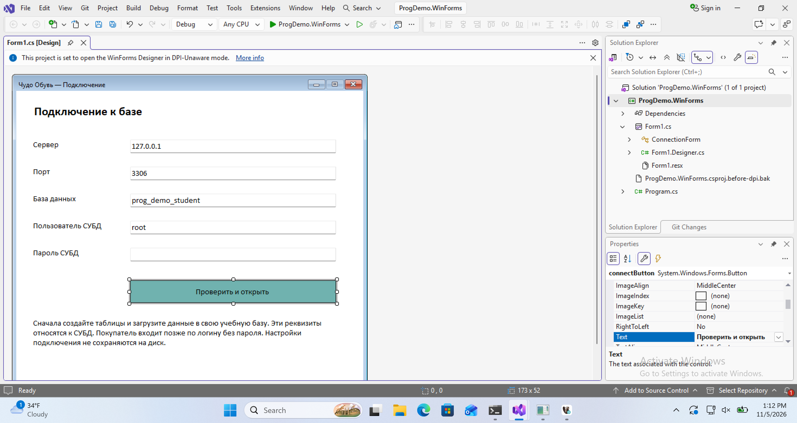

Проверьте сохранённый результат в Solution Explorer: обычный `.cs`, вложенный `.Designer.cs` и `.resx`. В автоматически созданном коде должны присутствовать пять полей TextBox, семь Label, одна Button, `AcceptButton = connectButton` и `connectButton.Click += connectButton_Click`. Это проверка результата сохранения, а не инструкция редактировать Designer.cs.

В обычном `.cs` реализуйте обработчик подключения по [примеру ConnectionForm.cs](../examples/WinForms/ConnectionForm.cs): проверка порта, сбор строки подключения, проверочный запрос и возврат результата. Здесь нет создания компонентов.


## Добавление следующей формы

Ctrl+Shift+A может сначала открыть компактное окно **Add new item**. Нажмите **Show all templates**, выберите **Form (Windows Forms)**, в Name укажите, например, `LoginForm.cs`, затем Add. Простое добавление файла `.cs` через компактное окно создаёт класс и не заменяет шаблон формы.

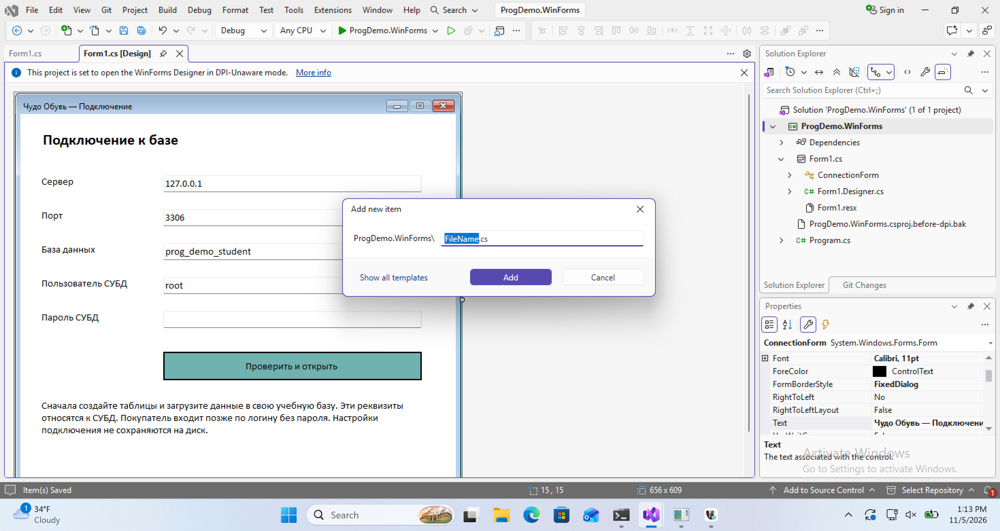

## Окно входа LoginForm

Добавьте `LoginForm.cs` указанным шаблоном. Задайте Font **Calibri, 11pt**, BackColor **White**, Text **Чудо Обувь — Вход**, FormBorderStyle **FixedDialog**, Size **506, 379**, MaximizeBox **False**, StartPosition **CenterParent**. Клиентская область в проверенном результате — **490 × 340**.

Добавьте компоненты из Toolbox. У Label перед Size отключите AutoSize. Компонент Toolbox можно выделить и добавить клавишей Enter.

| Компонент | (Name) | Location | Size | Остальные свойства |
| --- | --- | --- | --- | --- |
| Label | headingLabel | 24, 20 | 450, 40 | Text: Вход в Чудо Обувь; Font: Calibri 16pt Bold |
| Label | noteLabel | 24, 64 | 450, 60 | Text: Введите логин из списка пользователей. Пароль покупателя не требуется. |
| Label | loginLabel | 24, 140 | 100, 30 | Text: Логин |
| TextBox | loginTextBox | 140, 140 | 330, 25 | TabIndex 0 |
| Button | loginButton | 140, 200 | 160, 40 | Text: Войти; FlatStyle Flat; BackColor 112, 178, 175; TabIndex 1 |
| Button | guestButton | 310, 200 | 160, 40 | Text: Как гость; FlatStyle Flat; BackColor 210, 246, 231; TabIndex 2 |

Через вкладку событий создайте **loginButton.Click → loginButton_Click** и **guestButton.Click → guestButton_Click**. У самой формы задайте **AcceptButton = loginButton**. Проверьте сохранённые привязки и файлы формы. Прикладные функции находятся в [LoginForm.cs](../examples/WinForms/LoginForm.cs).

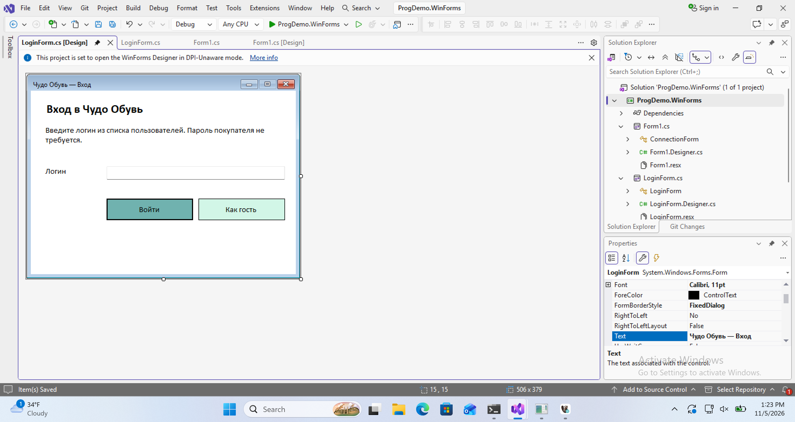

Закрытие окна крестиком отменяет смену пользователя. Кнопка «Как гость» явно выбирает гостевой режим. Если в каталоге есть незавершённый заказ, очистка подтверждается отдельно; отказ от очистки сохраняет прежнего пользователя и корзину. Эти функции требуют последующей проверки во время выполнения приложения.

## Карточка модели ProductForm

Добавьте `ProductForm.cs` шаблоном Form (Windows Forms). Свойства формы: Font **Calibri, 11pt**, Text **Чудо Обувь — Карточка модели**, BackColor **White**, FormBorderStyle **FixedDialog**, Size **716, 689**, MaximizeBox **False**, StartPosition **CenterParent**. Клиентская область — **700 × 650**.

| Компонент | (Name) | Location | Size | Дополнительные свойства |
| --- | --- | --- | --- | --- |
| PictureBox | photoPictureBox | 24, 24 | 652, 180 | SizeMode Zoom |
| Label | detailsLabel | 24, 220 | 652, 150 | AutoSize False; временная подпись о модели |
| Label | availableLabel | 24, 380 | 652, 46 | AutoSize False; две строки для размерного ряда и доступных размеров |
| Label | sizeLabel | 24, 430 | 100, 30 | AutoSize False; Text: Размер |
| Label | quantityLabel | 24, 480 | 100, 30 | AutoSize False; Text: Пар |
| ComboBox | sizeComboBox | 140, 430 | 300, 26 | DropDownStyle DropDownList; TabIndex 0 |
| NumericUpDown | quantityNumericUpDown | 140, 480 | 100, 25 | Maximum 1, Minimum 1, Value 1; TabIndex 1 |
| Button | addButton | 24, 540 | 300, 42 | Text: Добавить в заказ; BackColor 112, 178, 175; FlatStyle Flat; TabIndex 2 |
| Button | backButton | 340, 540 | 300, 42 | Text: Назад в каталог; BackColor 210, 246, 231; FlatStyle Flat; TabIndex 3 |

Создайте через вкладку событий четыре привязки:

- `sizeComboBox.SelectedIndexChanged → sizeComboBox_SelectedIndexChanged`;
- `addButton.Click → addButton_Click`;
- `backButton.Click → backButton_Click`;
- у самой формы `FormClosed → ProductForm_FormClosed`.

При переходе из обработчика обратно в конструктор проверьте поиск Toolbox: Visual Studio может сбросить его. Перед добавлением следующего компонента снова найдите нужный тип.

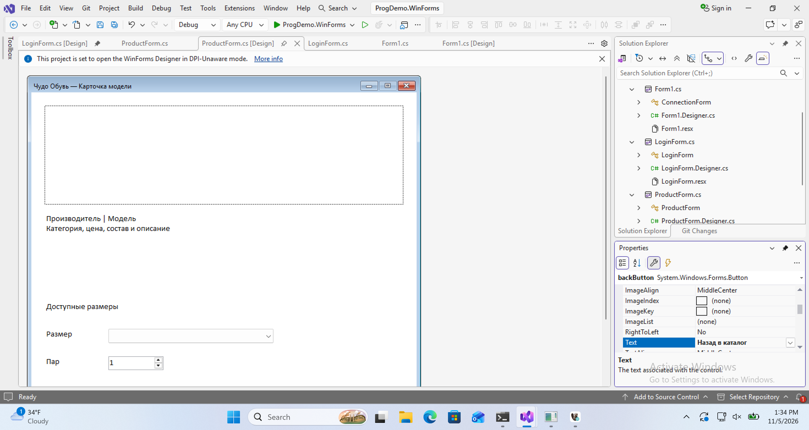

Если нижняя часть не помещается в редакторе Visual Studio, прокрутите **поверхность конструктора**, а не список свойств. В приложении это отдельное окно.

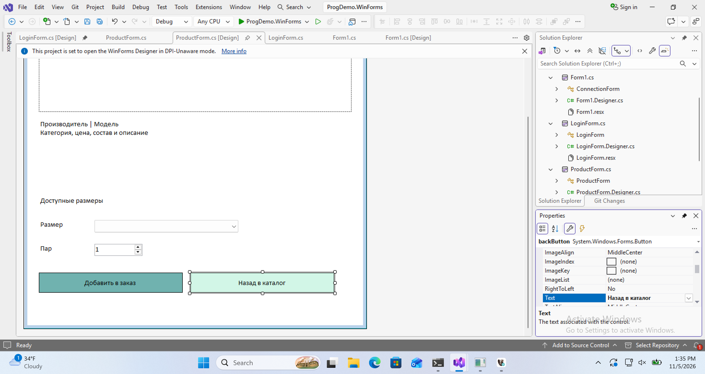

В [ProductForm.cs](../examples/WinForms/ProductForm.cs) запросы заполняют готовые объекты: изображение, описание и размерный ряд. В выпадающем списке остаются только размеры с положительным остатком. Функция RefreshLimit меняет Maximum существующего NumericUpDown по выбранному остатку. При закрытии освобождается загруженное изображение. Новые компоненты этот код не создаёт. Поведение с реальными данными проверяется следующим этапом.

## Корзина BasketForm

Добавьте форму через **Form (Windows Forms)**. Задайте Font **Calibri, 11pt**, Text **Чудо Обувь — Оформление заказа**, BackColor **White**, Size **996, 679**, MinimumSize **996, 560**, StartPosition **CenterParent**. Клиентская область — **980 × 640**. Минимальная ширина сохраняет место для трёх нижних кнопок.

Компоненты добавляйте через Toolbox, свойства — через Properties. У Label сначала задайте AutoSize **False**. Для кнопок задайте FlatStyle **Flat**; обычный BackColor **210, 246, 231**, у подтверждения **112, 178, 175**.

| Компонент | (Name) | Location | Size | Остальные свойства |
| --- | --- | --- | --- | --- |
| Label | headingLabel | 24, 16 | 800, 40 | Text: Оформление заказа; Font Calibri 16pt Bold |
| Label | customerLabel | 24, 70 | 100, 30 | Text: Клиент |
| Label | totalLabel | 650, 140 | 290, 30 | Text: Итого: 0,00 ₽; Anchor Top, Right |
| ComboBox | customerComboBox | 140, 70 | 530, 26 | DropDownStyle DropDownList; TabIndex 0 |
| NumericUpDown | quantityNumericUpDown | 24, 140 | 100, 25 | Maximum 100000, Minimum 1, Value 1; TabIndex 1 |
| Button | quantityButton | 140, 135 | 250, 40 | Text: Изменить количество; TabIndex 2 |
| Button | removeButton | 410, 135 | 220, 40 | Text: Удалить позицию; TabIndex 3 |
| DataGridView | basketGrid | 24, 190 | 932, 355 | Anchor Top, Bottom, Left, Right; TabIndex 4 |
| Button | backButton | 24, 575 | 250, 42 | Text: Назад к выбору; Anchor Bottom, Left; TabIndex 5 |
| Button | cancelButton | 284, 575 | 300, 42 | Text: Отказаться от заказа; Anchor Bottom, Left; TabIndex 6 |
| Button | confirmButton | 604, 575 | 352, 42 | Text: Подтвердить заказ; Anchor Bottom, Right; TabIndex 7 |

### Корзина: колонки и события

Для basketGrid задайте ReadOnly **True**, AllowUserToAddRows и AllowUserToDeleteRows **False**, MultiSelect и RowHeadersVisible **False**, SelectionMode **FullRowSelect**, BackgroundColor **White**, AutoSizeColumnsMode **Fill**, AutoSizeRowsMode **AllCells**.

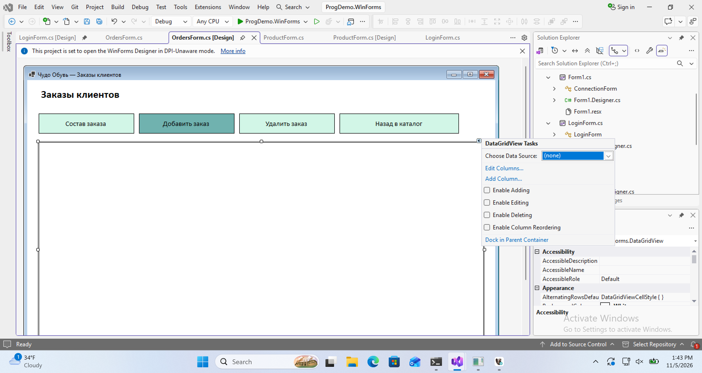

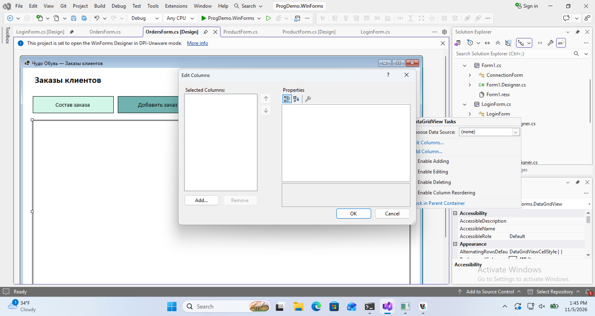

На снимках редактор открыт для списка заказов. Корзина, состав заказа и каталог используют тот же редактор.

Выделите саму таблицу в конструкторе. У её правого верхнего угла появится маленькая стрелка. Откройте стрелку **DataGridView Tasks → Edit Columns… → Add…**. Выберите **Unbound column**, тип **DataGridViewTextBoxColumn**. Добавьте шесть колонок, затем закройте Add Column кнопкой Close. В Edit Columns выделяйте каждую колонку слева и заполняйте свойства справа:

| (Name) | HeaderText | DataPropertyName | FillWeight | DefaultCellStyle |
| --- | --- | --- | --- | --- |
| stockIdColumn | Позиция | StockId | 45 | по умолчанию |
| productColumn | Модель | Product | 250 | по умолчанию |
| sizeColumn | Размер | Size | 45 | по умолчанию |
| quantityColumn | Пар | Quantity | 40 | по умолчанию |
| priceColumn | Цена, ₽ | Price | 75 | Format N2; Alignment MiddleRight |
| totalColumn | Сумма, ₽ | Total | 75 | Format N2; Alignment MiddleRight |

У каждой колонки задайте ReadOnly **True**, SortMode **NotSortable**. Не добавляйте колонки заново в обработчиках. В DefaultCellStyle у цен и суммы кнопка **…** открывает **CellStyle Builder**; там задаются Format и Alignment. У самого basketGrid откройте DefaultCellStyle через **…** и установите WrapMode **True**. При AutoSizeRowsMode **AllCells** длинное название модели переносится по строкам.

Через вкладку событий свяжите пять кнопок с одноимёнными обработчиками `…_Click` и `basketGrid.SelectionChanged → basketGrid_SelectionChanged`. При возврате из обработчика убедитесь, что активна вкладка **BasketForm.cs [Design]**; если Shift+F7 не переключил её, выберите вкладку мышью.

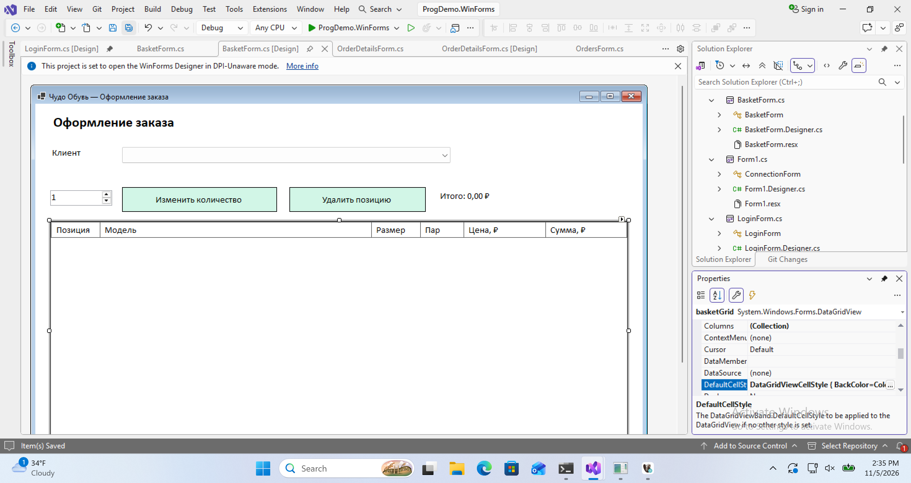

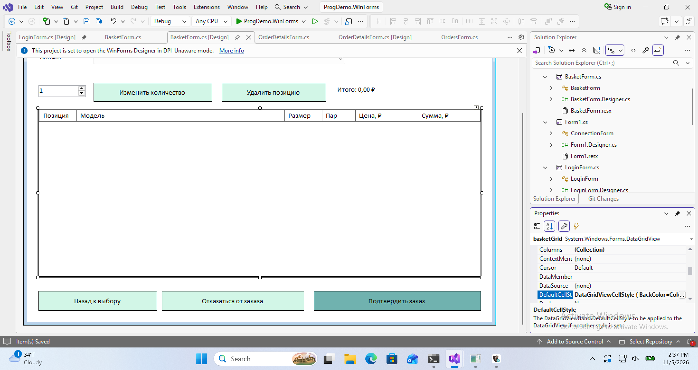

В обычном [BasketForm.cs](../examples/WinForms/BasketForm.cs) реализуйте привязку данных к готовым колонкам и функции кнопок. Строка выбирается по StockId. «Назад к выбору» сохраняет корзину; «Отказаться» запрашивает подтверждение очистки; «Подтвердить» вызывает транзакцию и повторно использует идентификатор запроса при повторе после ошибки. Обновление состава корзины создаёт новый идентификатор запроса. Для клиента список покупателей недоступен, для менеджера и администратора заполняется запросом. Проверка ролей повторяется в Store.


## Список заказов OrdersForm

Добавьте форму шаблоном **Form (Windows Forms)**. Сначала задайте Font **Calibri, 11pt**, затем Size **996, 679**, MinimumSize **996, 560**, BackColor **White**, StartPosition **CenterParent**, Text **Чудо Обувь — Заказы клиентов**. Размеры ниже относятся к конструктору при 96 DPI. У Label перед заданием Size выключите AutoSize.

| Компонент | (Name) | Location | Size | Остальные свойства |
| --- | --- | --- | --- | --- |
| Label | headingLabel | 24, 16 | 600, 40 | Text: Заказы клиентов; Font: Calibri, 16pt, style=Bold |
| Label | statusLabel | 24, 595 | 932, 25 | Text: Заказов: 0; Anchor: Bottom, Left, Right |
| Button | detailsButton | 24, 70 | 200, 42 | Text: Состав заказа; BackColor: 210, 246, 231; FlatStyle: Flat; TabIndex: 0 |
| Button | addOrderButton | 234, 70 | 200, 42 | Text: Добавить заказ; BackColor: 112, 178, 175; FlatStyle: Flat; TabIndex: 1 |
| Button | deleteOrderButton | 444, 70 | 200, 42 | Text: Удалить заказ; BackColor: 210, 246, 231; FlatStyle: Flat; TabIndex: 2 |
| Button | backButton | 654, 70 | 250, 42 | Text: Назад в каталог; BackColor: 210, 246, 231; FlatStyle: Flat; TabIndex: 3 |
| DataGridView | ordersGrid | 24, 130 | 932, 450 | Anchor: Top, Bottom, Left, Right; AllowUserToAddRows: False; AllowUserToDeleteRows: False; ReadOnly: True; MultiSelect: False; RowHeadersVisible: False; SelectionMode: FullRowSelect; BackgroundColor: White; AutoSizeColumnsMode: Fill; TabIndex: 4 |

### Список заказов: колонки и события

Для DataGridView откройте стрелку **DataGridView Tasks → Edit Columns… → Add…**. Создавайте **Unbound column**. Для каждой колонки явно выбирайте тип: после ImageColumn редактор может сохранить этот тип для следующей колонки. После добавления закройте Add Column кнопкой Close и заполните свойства каждой колонки в Edit Columns.

| (Name) | Тип | HeaderText | DataPropertyName | FillWeight | Дополнительно |
| --- | --- | --- | --- | --- | --- |
| idColumn | DataGridViewTextBoxColumn | № заказа | Id | 35 | по умолчанию |
| dateColumn | DataGridViewTextBoxColumn | Дата заказа | Date | 60 | DefaultCellStyle.Format dd.MM.yyyy |
| customerColumn | DataGridViewTextBoxColumn | ФИО клиента | Customer | 180 | по умолчанию |
| totalColumn | DataGridViewTextBoxColumn | Итог, ₽ | Total | 60 | DefaultCellStyle.Format N2; Alignment MiddleRight |

У всех колонок ReadOnly **True**, у текстовых SortMode **NotSortable**. В DefaultCellStyle кнопка **…** открывает CellStyle Builder. У самой ordersGrid задайте DefaultCellStyle.WrapMode **True** и AutoSizeRowsMode **AllCells**.

На вкладке событий Properties создайте или выберите следующие обработчики; после каждого возвращайтесь на вкладку формы **[Design]**.

- `detailsButton.Click → detailsButton_Click`;
- `addOrderButton.Click → addOrderButton_Click`;
- `deleteOrderButton.Click → deleteOrderButton_Click`;
- `backButton.Click → backButton_Click`;

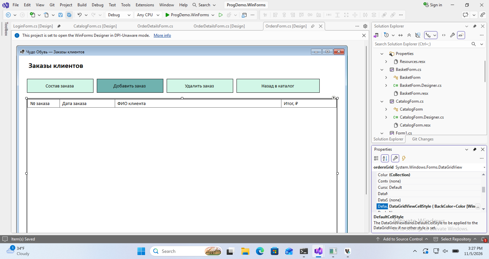

Сохраните автоматически созданные Designer.cs и resx. В обычном [OrdersForm.cs](../examples/WinForms/OrdersForm.cs) реализуйте функции по файлу сверки. При полной замене обычного .cs не удаляйте вложенные файлы конструктора. Этот код привязывает данные, выполняет запросы и обрабатывает события готовых компонентов.


## Состав заказа OrderDetailsForm

Добавьте форму шаблоном **Form (Windows Forms)**. Сначала задайте Font **Calibri, 11pt**, затем Size **996, 679**, MinimumSize **996, 560**, BackColor **White**, StartPosition **CenterParent**, Text **Чудо Обувь — Состав заказа**. Размеры ниже относятся к конструктору при 96 DPI. У Label перед заданием Size выключите AutoSize.

| Компонент | (Name) | Location | Size | Остальные свойства |
| --- | --- | --- | --- | --- |
| Label | headingLabel | 24, 16 | 800, 40 | Text: Состав заказа; Font: Calibri, 16pt, style=Bold |
| Label | dateLabel | 24, 70 | 120, 30 | Text: Дата заказа |
| Label | totalLabel | 290, 590 | 650, 30 | Text: Итого: 0,00 ₽; Anchor: Bottom, Left, Right |
| DateTimePicker | orderDatePicker | 150, 70 | 160, 25 | Format: Custom; TabIndex: 0; CustomFormat: dd.MM.yyyy |
| Button | changeDateButton | 330, 65 | 240, 40 | Text: Изменить дату; BackColor: 112, 178, 175; FlatStyle: Flat; TabIndex: 1 |
| Button | deleteLineButton | 590, 65 | 240, 40 | Text: Удалить строку; BackColor: 210, 246, 231; FlatStyle: Flat; TabIndex: 2 |
| Button | backButton | 24, 585 | 240, 40 | Text: Назад к заказам; BackColor: 210, 246, 231; FlatStyle: Flat; TabIndex: 4; Anchor: Bottom, Left |
| DataGridView | linesGrid | 24, 130 | 932, 430 | Anchor: Top, Bottom, Left, Right; AllowUserToAddRows: False; AllowUserToDeleteRows: False; ReadOnly: True; MultiSelect: False; RowHeadersVisible: False; SelectionMode: FullRowSelect; BackgroundColor: White; AutoSizeColumnsMode: Fill; TabIndex: 3 |

### Состав заказа: колонки и события

Для DataGridView откройте стрелку **DataGridView Tasks → Edit Columns… → Add…**. Создавайте **Unbound column**. Для каждой колонки явно выбирайте тип: после ImageColumn редактор может сохранить этот тип для следующей колонки. После добавления закройте Add Column кнопкой Close и заполните свойства каждой колонки в Edit Columns.

| (Name) | Тип | HeaderText | DataPropertyName | FillWeight | Дополнительно |
| --- | --- | --- | --- | --- | --- |
| lineIdColumn | DataGridViewTextBoxColumn | № строки | Id | 35 | по умолчанию |
| stockIdColumn | DataGridViewTextBoxColumn | Код позиции | StockId | 30 | Visible False |
| productColumn | DataGridViewTextBoxColumn | Модель | Product | 180 | по умолчанию |
| manufacturerColumn | DataGridViewTextBoxColumn | Производство | Manufacturer | 120 | по умолчанию |
| sizeColumn | DataGridViewTextBoxColumn | Размер | Size | 45 | по умолчанию |
| quantityColumn | DataGridViewTextBoxColumn | Пар | Quantity | 35 | по умолчанию |
| priceColumn | DataGridViewTextBoxColumn | Цена, ₽ | Price | 60 | DefaultCellStyle.Format N2; Alignment MiddleRight |
| totalColumn | DataGridViewTextBoxColumn | Сумма, ₽ | Total | 60 | DefaultCellStyle.Format N2; Alignment MiddleRight |

У всех колонок ReadOnly **True**, у текстовых SortMode **NotSortable**. В DefaultCellStyle кнопка **…** открывает CellStyle Builder. У самой linesGrid задайте DefaultCellStyle.WrapMode **True** и AutoSizeRowsMode **AllCells**.

У orderDatePicker задайте **Format Custom**, **CustomFormat dd.MM.yyyy**: вариант Short зависит от языка Windows и может показать месяц перед днём. Код позиции StockId сохранён в скрытой колонке, а пользователю показываются модель и размер.

На вкладке событий Properties создайте или выберите следующие обработчики; после каждого возвращайтесь на вкладку формы **[Design]**.

- `changeDateButton.Click → changeDateButton_Click`;
- `deleteLineButton.Click → deleteLineButton_Click`;
- `backButton.Click → backButton_Click`;

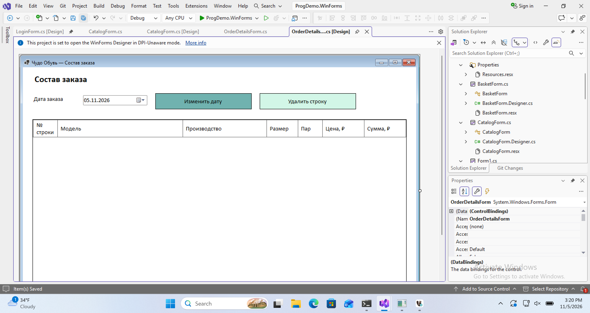

Сохраните автоматически созданные Designer.cs и resx. В обычном [OrderDetailsForm.cs](../examples/WinForms/OrderDetailsForm.cs) реализуйте функции по файлу сверки. При полной замене обычного .cs не удаляйте вложенные файлы конструктора. Этот код привязывает данные, выполняет запросы и обрабатывает события готовых компонентов.


## Каталог CatalogForm

Добавьте форму шаблоном **Form (Windows Forms)**. Сначала задайте Font **Calibri, 11pt**, затем Size **1016, 679**, MinimumSize **1016, 560**, BackColor **White**, StartPosition **CenterScreen**, Text **Чудо Обувь — Каталог**. Размеры ниже относятся к конструктору при 96 DPI. У Label перед заданием Size выключите AutoSize.

| Компонент | (Name) | Location | Size | Остальные свойства |
| --- | --- | --- | --- | --- |
| PictureBox | logoPictureBox | 24, 12 | 85, 65 | SizeMode: Zoom |
| Label | titleLabel | 125, 12 | 450, 65 | Text: Чудо Обувь; Каталог моделей и размеров; Font: Calibri, 16pt, style=Bold |
| Label | identityLabel | 600, 12 | 360, 65 | Text: Гость; Anchor: Top, Right; TextAlign: MiddleRight |
| Button | loginButton | 24, 100 | 250, 40 | Text: Войти / сменить пользователя; BackColor: 210, 246, 231; FlatStyle: Flat; TabIndex: 0 |
| Button | cartButton | 285, 100 | 200, 40 | Text: Мой заказ (0); BackColor: 112, 178, 175; FlatStyle: Flat; TabIndex: 1 |
| Button | ordersButton | 495, 100 | 200, 40 | Text: Заказы клиентов; BackColor: 210, 246, 231; FlatStyle: Flat; TabIndex: 2 |
| Button | refreshButton | 705, 100 | 250, 40 | Text: Обновить каталог; BackColor: 210, 246, 231; FlatStyle: Flat; TabIndex: 3 |
| Label | dateLabel | 24, 150 | 600, 30 | Text: Дата расчёта |
| Label | searchLabel | 24, 190 | 60, 30 | Text: Поиск |
| TextBox | searchTextBox | 90, 190 | 260, 25 | Text: ; PlaceholderText: Название или описание; TabIndex: 4 |
| ComboBox | categoryComboBox | 370, 190 | 250, 26 | DropDownStyle: DropDownList; TabIndex: 5 |
| ComboBox | sortComboBox | 640, 190 | 315, 26 | DropDownStyle: DropDownList; TabIndex: 6 |
| Label | statusLabel | 24, 595 | 952, 25 | Text: Выберите модель двойным щелчком; Anchor: Bottom, Left, Right |
| DataGridView | catalogGrid | 24, 235 | 952, 350 | Anchor: Top, Bottom, Left, Right; AllowUserToAddRows: False; AllowUserToDeleteRows: False; ReadOnly: True; MultiSelect: False; RowHeadersVisible: False; ColumnHeadersVisible: False; SelectionMode: FullRowSelect; BackgroundColor: White; AutoSizeColumnsMode: Fill; TabIndex: 7 |

### Каталог: колонки и события

Для DataGridView откройте стрелку **DataGridView Tasks → Edit Columns… → Add…**. Создавайте **Unbound column**. Для каждой колонки явно выбирайте тип: после ImageColumn редактор может сохранить этот тип для следующей колонки. После добавления закройте Add Column кнопкой Close и заполните свойства каждой колонки в Edit Columns.

| (Name) | Тип | HeaderText | DataPropertyName | FillWeight | Дополнительно |
| --- | --- | --- | --- | --- | --- |
| imageColumn | DataGridViewImageColumn | Фото | Image | 130 | ImageLayout Zoom |
| detailsColumn | DataGridViewTextBoxColumn | Модель | Details | 650 | по умолчанию |
| priceColumn | DataGridViewTextBoxColumn | Цена | Price | 170 | DefaultCellStyle.Format C2; Alignment MiddleRight; DefaultCellStyle.Font Calibri, 16pt, style=Bold |

У всех колонок ReadOnly **True**, у текстовых SortMode **NotSortable**. В DefaultCellStyle кнопка **…** открывает CellStyle Builder. У самой catalogGrid задайте DefaultCellStyle.WrapMode **True** и AutoSizeRowsMode **AllCells**. Также задайте RowTemplate → Height **160** и ColumnHeadersVisible **False**.

У logoPictureBox откройте Image → **… → Local resource → Import…**, выберите исходный «Чудо Обувь.png» и нажмите OK. Ресурс сохранится в resx этой формы. В sortComboBox откройте Items → **…**; в String Collection Editor введите две отдельные строки: «Цена: по возрастанию» и «Цена: по убыванию», затем OK.

На вкладке событий Properties создайте или выберите следующие обработчики; после каждого возвращайтесь на вкладку формы **[Design]**.

- `loginButton.Click → loginButton_Click`;
- `cartButton.Click → cartButton_Click`;
- `ordersButton.Click → ordersButton_Click`;
- `refreshButton.Click → refreshButton_Click`;
- `searchTextBox.TextChanged → searchTextBox_TextChanged`;
- `categoryComboBox.SelectedIndexChanged → categoryComboBox_SelectedIndexChanged`;
- `sortComboBox.SelectedIndexChanged → sortComboBox_SelectedIndexChanged`;
- `catalogGrid.CellDoubleClick → catalogGrid_CellDoubleClick`;
- `catalogGrid.CellFormatting → catalogGrid_CellFormatting`;
- у формы `FormClosed → CatalogForm_FormClosed`.

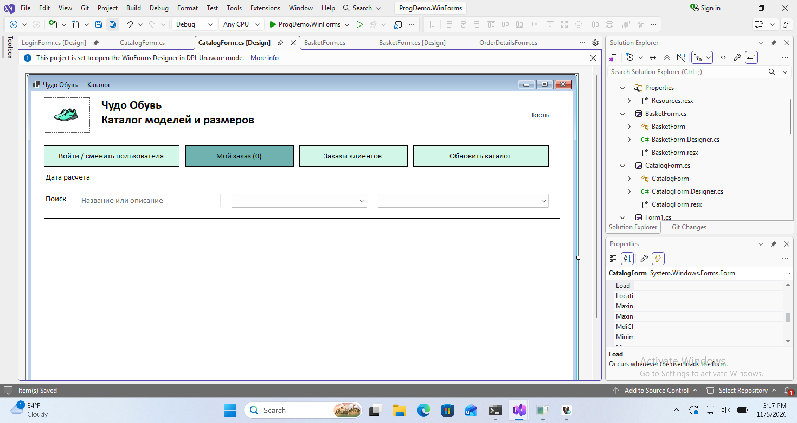

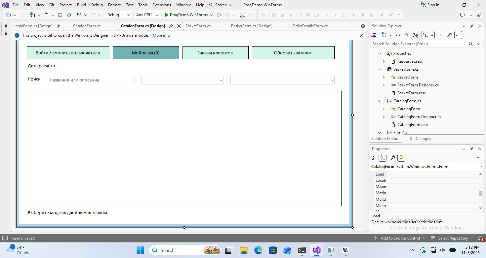

Сохраните автоматически созданные Designer.cs и resx. В обычном [CatalogForm.cs](../examples/WinForms/CatalogForm.cs) реализуйте функции по файлу сверки. При полной замене обычного .cs не удаляйте вложенные файлы конструктора. Этот код привязывает данные, выполняет запросы и обрабатывает события готовых компонентов.

Для catalogGrid обязательно задайте **AutoSizeRowsMode = AllCells** вместе с DefaultCellStyle.WrapMode = True. При масштабе Windows 200% фиксированные 160 пикселей обрезали длинный состав; автоматическая высота устраняет обрезку. У самой CatalogForm через **Icon → …** выберите исходный Assets/Чудо Обувь.ico: значок формы хранится в её resx отдельно от значка exe в свойствах проекта.

## Сверьте работающие окна

После F5 подключитесь к учебной базе. В гостевом режиме открывается список моделей. После входа покупателя проверьте поиск, категорию и порядок цен. В категории «Детская обувь» исходного набора девять моделей. Сверьте логотип, Calibri и цвета White, #D2F6E7 и #70B2AF. Если фото отсутствует, приложение показывает picture.png.

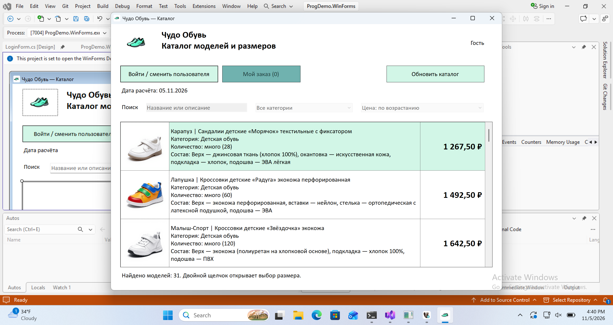

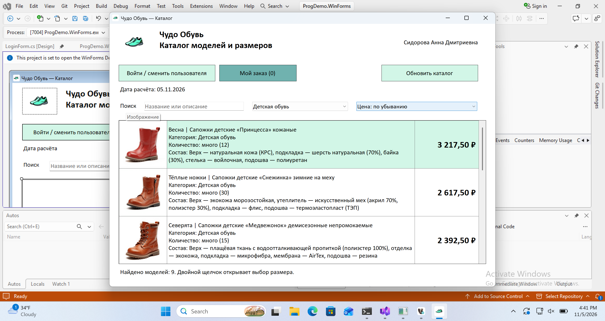

### Сверка ролей

Перед сменой роли вернитесь в каталог. Если в пробной корзине остались позиции, подтвердите её очистку в диалоге «Смена пользователя». Откройте состав одного и того же заказа под администратором и менеджером. У администратора видны дата и действия её изменения и удаления строки. У менеджера доступен просмотр состава.

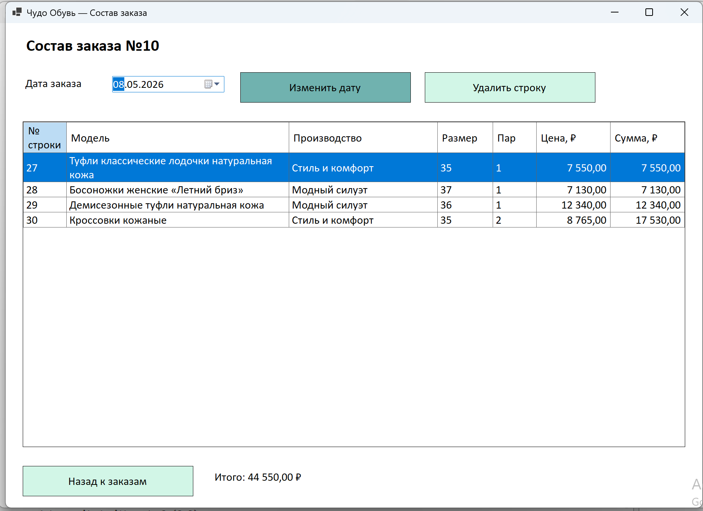

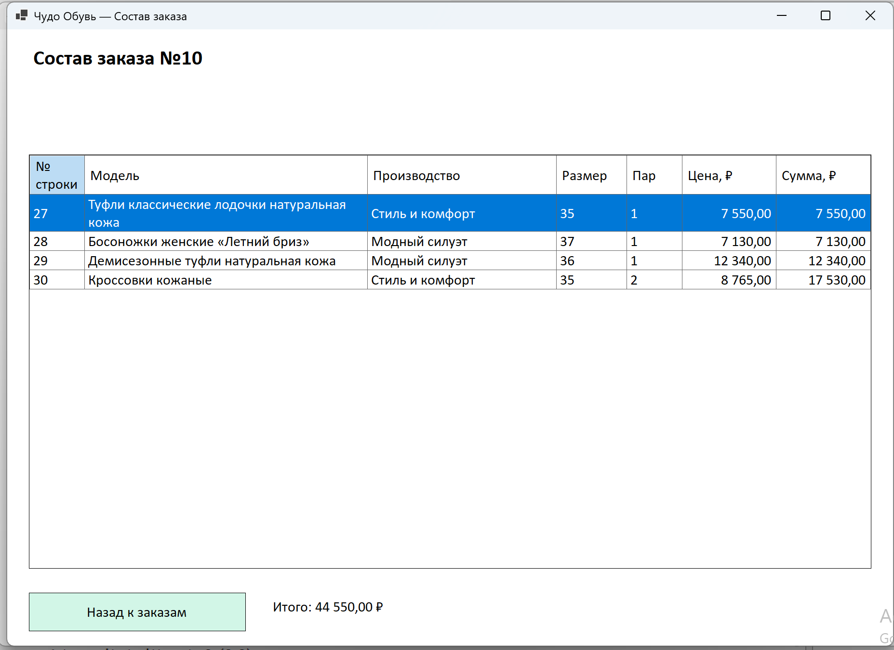
