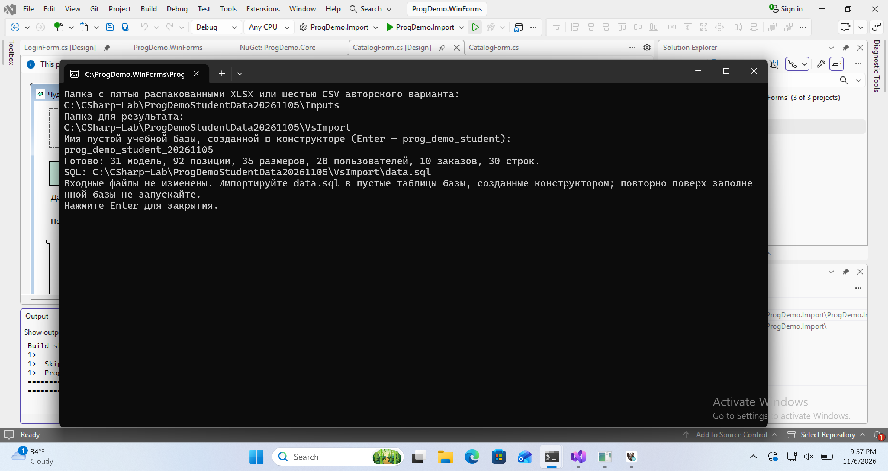

# Подготовка данных в C#

Импортёр читает исходные файлы, проверяет связи и создаёт SQL с данными для уже созданных в DBeaver таблиц. Исходные файлы сохраняйте отдельно. Для образца нужны пять распакованных XLSX; для своего учебного варианта — его шесть CSV.

## Создайте консольный проект

1. Если Visual Studio открыта без решения, нажмите **Create a new project**. Если решение уже открыто, выберите **File → Add → New Project…**. Найдите **Console App**, язык **C#**, без пометки .NET Framework.
2. Имя проекта — **ProgDemo.Import**. Выберите **.NET 10.0** и нажмите Create.
3. Замените обычный Program.cs содержимым [Program.cs импортёра](../examples/Import/Program.cs).
4. Через **Project → Add Class…** добавьте **CsvInput.cs** и замените его содержимым [CsvInput.cs](../examples/Import/CsvInput.cs). Оба файла относятся к одному проекту C#.
5. Выберите **Project → Set as Startup Project** для ProgDemo.Import, затем **Build → Build Solution**. В этом проекте дополнительные пакеты NuGet не нужны. Используемый TextFieldParser входит в .NET; пространство имён Microsoft.VisualBasic.FileIO доступно и из C#.

### Если доступен только Console App (.NET Framework)

Откройте Terminal в Visual Studio и перейдите в папку с файлом решения. Выполните:

```powershell
dotnet new console --framework net10.0 --name ProgDemo.Import --output ProgDemo.Import
```

Щёлкните правой кнопкой по **Solution → Add → Existing Project…** и выберите **ProgDemo.Import/ProgDemo.Import.csproj**. После добавления выполните шаги 3–5 выше.

## Укажите входные файлы

Для официального образца распакуйте [оригинальный комплект](../downloads/original-inputs.zip), затем ZIP приложения к заданию. Найдите папку, непосредственно содержащую Products_import.xlsx, Stock_Items_import.xlsx, Sizes_import.xlsx, Users_import.xlsx и Orders_import.xlsx. Папка, содержащая только внешний ZIP, не подойдёт.

Для своего учебного варианта распакуйте его отдельный комплект. Найдите рядом **products.csv**, **stock.csv**, **sizes.csv**, **users.csv**, **orders.csv**, **items.csv**. В начале выберите свой вариант на странице пробного экзамена: там скачивается именно его архив.

1. Нажмите **Ctrl+F5** для запуска консольного импортёра.
2. На первый вопрос вставьте полный путь к папке с XLSX либо CSV и нажмите Enter. Кавычки вокруг пути допустимы.
3. На второй вопрос укажите отдельную новую папку результата, например `C:\DE2027\Prepared`. Для повторной проверки укажите другую пустую папку: существующий data.sql не перезаписывается.
4. На третий вопрос введите имя пустой БД, уже созданной через конструктор DBeaver, например `prog_demo_student`. Проверьте латинские буквы, цифры и подчёркивания в имени.
5. Дождитесь сообщения «Готово». Для исходного образца ожидаются **31 модель, 92 позиции, 35 размеров, 20 пользователей, 10 заказов, 30 строк заказа**.



Импортёр не запрашивает пароль СУБД и не подключается к серверу. Файлы результата — **data.sql** и **import-report.json**. В отчёте сохраняются контрольные количества, решения сопоставления и SHA-256 исходных файлов.

## Проверьте сопоставление

В образце встречаются лишние пробелы и сокращённое название модели. Сравните правила Normalize и явное сопоставление в Program.cs с исходниками. Пробельная нормализация разрешает 13 несовпадений; для четырёх строк требуется явно записанное правило сокращённого названия. Не добавляйте новые товары только ради расхождения написания и не исправляйте оригинальные книги.

Для CSV проверяются уникальные последовательные идентификаторы, ссылки строки на заказ и складскую позицию, покупатель, дата и ФИО. В исходной истории stock_accounted должен быть False: исторические остатки уже даны отдельно.

## Загрузите результат

Откройте data.sql в DBeaver. Первая строка USE должна указывать вашу учебную БД. Далее идут START TRANSACTION, INSERT и COMMIT. Выполните весь скрипт по [инструкции загрузки в DBeaver](DBeaver.md), затем проверьте количества отдельным запросом.

Сдаваемый SQL со структурой и данными получите экспортом готовой БД из DBeaver. Файл data.sql используется только для начальной загрузки данных в созданные конструктором таблицы.
