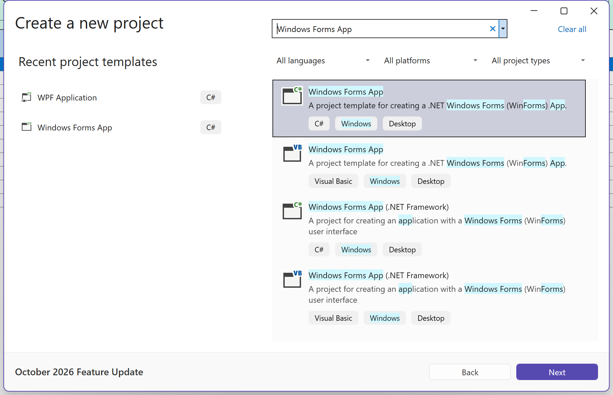
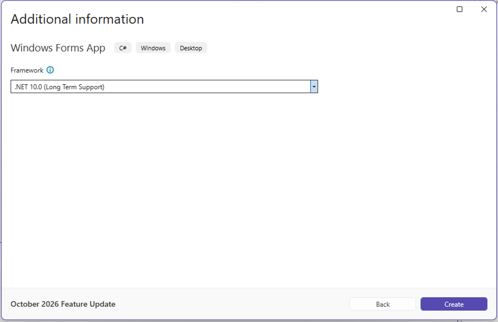
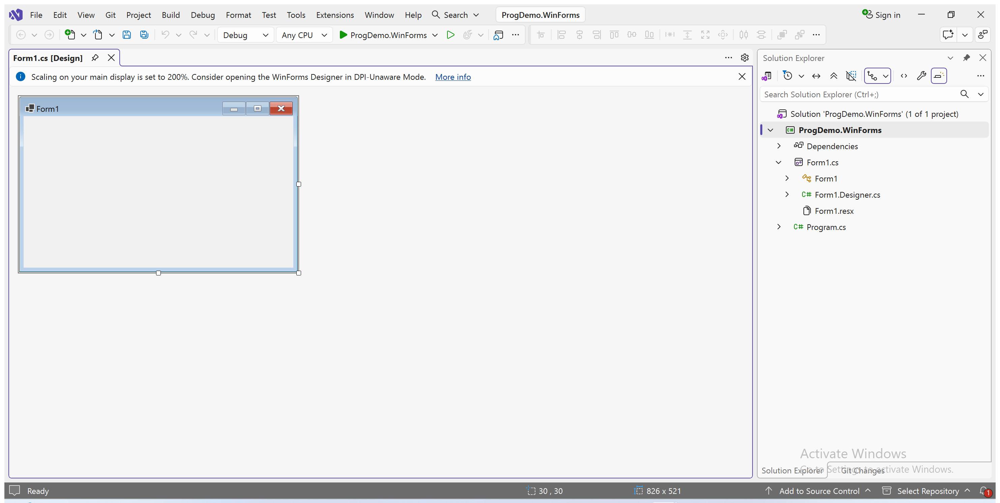
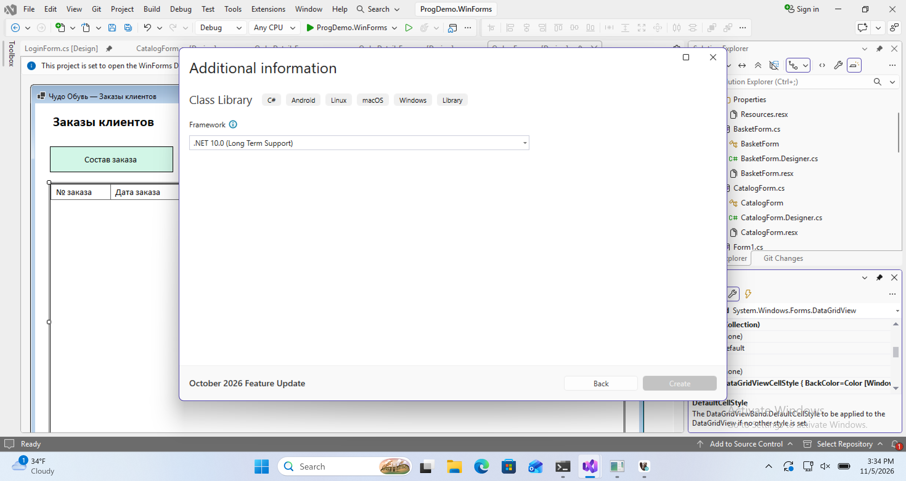
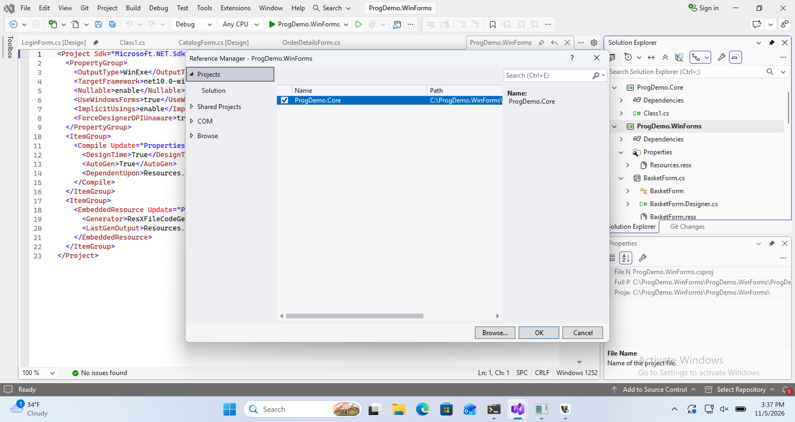
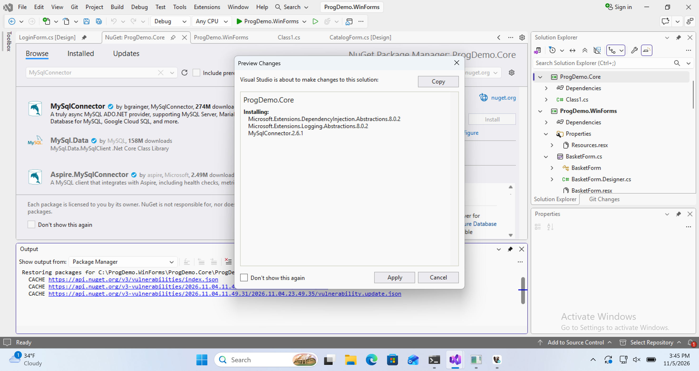
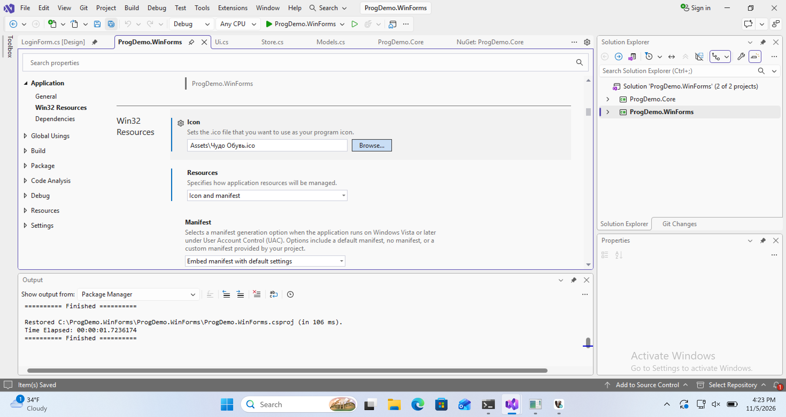
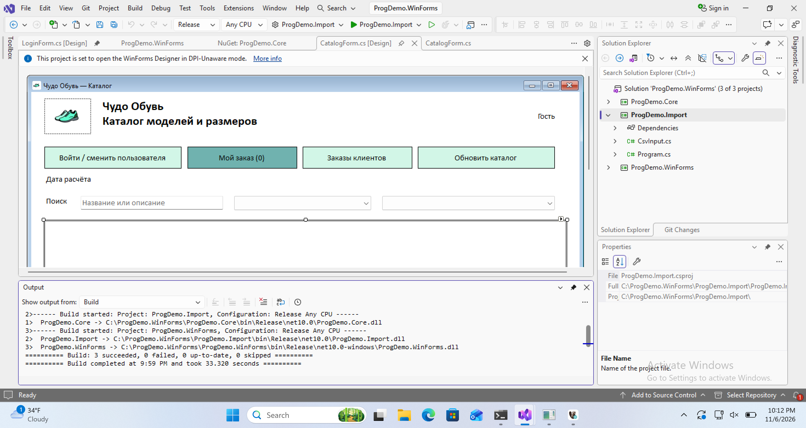
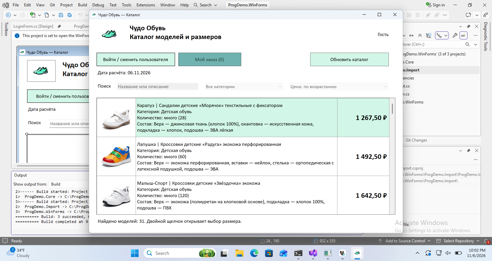

# Настройка решения Visual Studio

## Подготовьте Windows

1. Создайте рабочую папку `C:\DE2027`. В ней создайте две папки — `Reference` для готового примера и `Work` для своего проекта. Скачайте [единый ZIP примера](../downloads/prog-demo-example.zip), распакуйте его в Reference и убедитесь, что внутри видны `ProgDemo.sln`, `content` и `materials`.
2. Скачайте [Visual Studio Community](https://visualstudio.microsoft.com/downloads/) для Windows. В Visual Studio Installer отметьте **.NET desktop development** (разработка классических приложений .NET) и установите .NET 10 SDK. Если Visual Studio уже установлена, откройте Installer → **Modify** и добавьте ту же рабочую нагрузку.
3. В Windows откройте PowerShell, выполните `dotnet --list-sdks` и проверьте наличие строки, начинающейся с `10.0`. В Visual Studio должен находиться шаблон **Windows Forms App** на C# с платформой .NET 10.
4. Установите [DBeaver Community](https://dbeaver.io/download/) и подготовьте сервер по разделу [«Первое подключение в DBeaver»](../?mode=learn&module=M1&view=steps&card=%D0%97%D0%B0%D0%BF%D1%83%D1%81%D1%82%D0%B8%D1%82%D0%B5+%D1%81%D0%B5%D1%80%D0%B2%D0%B5%D1%80+%D0%B8+%D0%BF%D1%80%D0%BE%D0%B2%D0%B5%D1%80%D1%8C%D1%82%D0%B5+%D0%BF%D0%BE%D0%B4%D0%BA%D0%BB%D1%8E%D1%87%D0%B5%D0%BD%D0%B8%D0%B5). DBeaver открывает подключение и редактирует таблицы. Сервер MySQL / MariaDB запускается отдельно.
5. Чтобы увидеть ожидаемый результат, выполните [запуск готового примера](launch.html) из Reference и дождитесь гостевого каталога. Для примера используется база `prog_demo_sample`, для самостоятельного задания — отдельная база `prog_demo_student`.

## Создайте одно решение для всего маршрута

1. Закройте готовое решение из Reference, если оно открыто. В стартовом окне нажмите **Create a new project**. Если редактор уже открыт, выберите **File → New → Project**. В поиске введите **Windows Forms App**, выберите карточку с меткой **C#** без пометки **.NET Framework** и нажмите **Next**.
2. Укажите проект **ProgDemo.WinForms**, решение **ProgDemo**, путь `C:\DE2027\Work`. Оставьте флажок **Place solution and project in the same directory** снятым, чтобы проекты лежали в отдельных подпапках. Нажмите **Next**, выберите **.NET 10.0** и нажмите **Create**. В Solution Explorer должны появиться решение ProgDemo и проект с файлом Form1.cs. Visual Studio 2026 может сохранить решение как `ProgDemo.slnx`. Нажмите F5. Должен открыться пустой Form1. Закройте окно.
3. Во время задания 1 добавьте в это решение [консольный проект ProgDemo.Import](../?mode=learn&module=M1&view=steps&card=%D0%A1%D0%BE%D0%B7%D0%B4%D0%B0%D0%B9%D1%82%D0%B5+%D0%BA%D0%BE%D0%BD%D1%81%D0%BE%D0%BB%D1%8C%D0%BD%D1%8B%D0%B9+%D0%BF%D1%80%D0%BE%D0%B5%D0%BA%D1%82). После импорта вернитесь к оконному проекту в том же решении. Файлы из Reference используйте для сверки.

## Добавьте библиотеку

1. В уже открытом решении Windows Forms выберите **File → Add → New Project…**.
2. Найдите **Class Library**, выберите C# без пометки .NET Framework. Имя — **ProgDemo.Core**, платформа — **.NET 10.0**. Нажмите Create.
3. Выделите ProgDemo.WinForms в Solution Explorer. Выберите **Project → Add Project Reference…**, слева Projects → Solution, отметьте ProgDemo.Core и нажмите OK.
4. Раскройте Dependencies оконного проекта: ссылка на Core должна появиться в Projects.

## Установите пакет и добавьте обычные классы

1. Щёлкните правой кнопкой по ProgDemo.Core → **Manage NuGet Packages… → Browse**.
2. Найдите **MySqlConnector**, выберите пакет с этим точным именем. В Version выберите **2.6.1**, нажмите Install, проверьте список изменений и нажмите Apply. Если Visual Studio покажет условия пакета, прочитайте их перед подтверждением.
3. Убедитесь, что показано **Installed: 2.6.1**. В оконный проект повторно устанавливать пакет не требуется: зависимость приходит через Core.

## Подключите изображения

1. В папке проекта ProgDemo.WinForms создайте **Assets**, внутри — **Images**. Скопируйте оригинальные 31 фотографию в Images, а picture.png и «Чудо Обувь.png» — в Assets. Поместите туда же «Чудо Обувь.ico».
2. В Solution Explorer раскройте Assets → Images. Выделите первую фотографию, затем с Shift последнюю: должны быть выделены все 31 PNG, без папки.
3. Нажмите F4. В **Copy to Output Directory** выберите **Copy if newer**. Повторите для Assets/picture.png. Нажмите **Save All**.
4. Для логотипа каталога отдельно используйте PictureBox → Image → Local resource → Import по инструкции формы. Такой логотип сохраняется внутри ресурса формы.
5. Выделите проект ProgDemo.WinForms, откройте **Project → ProgDemo.WinForms Properties → Application → Win32 Resources**.
6. У поля **Icon** нажмите Browse и выберите **Assets/Чудо Обувь.ico**. Нажмите Save All. В поле Icon должен остаться относительный путь к файлу.

## Настройте точку входа

1. После создания всех форм перенесите код обычных файлов форм по ссылкам в инструкции. В конце замените **Program.cs оконного проекта** содержимым [Program.cs примера](../examples/WinForms/Program.cs). Он запускает окно подключения и передаёт соединение в каталог. В решении два Program.cs: файл импортёра оставьте прежним.

## Соберите и запустите

1. Для оконного проекта выберите **Set as Startup Project**, если он не выделен жирным в Solution Explorer.
2. Выберите **Build → Build Solution**. В Output должно быть **2 succeeded, 0 failed**, если в решении только библиотека и оконный проект. С добавленным импортёром проверьте три проекта. Уже собранные проекты могут быть помечены **up-to-date**. Ошибок должно быть 0.
3. В папке bin/Debug/net10.0-windows проверьте Assets/Images и Assets/picture.png. Если их нет, повторите настройку копирования, затем сборку.
4. Нажмите F5. В окне подключения введите адрес, порт и имя **своей** базы. Порт зависит от вашей установки; в проверенной VM использовался 3307. Пользователь и пароль здесь относятся к СУБД.
5. Нажмите «Проверить и открыть». Откроется каталог. Покупатель входит позже по исходному логину без пароля.

## Соберите результат для сдачи

1. Выберите Release в верхнем списке конфигурации и выполните **Build → Build Solution**.
2. Скопируйте целиком папку bin/Release/net10.0-windows оконного проекта в отдельную папку App. Оставьте в ней exe, dll, runtimeconfig.json, deps.json и Assets.
3. Запустите ProgDemo.WinForms.exe из App. Подключитесь к восстановленной учебной базе и проверьте открытие каталога с фотографиями. Для запуска этой сборки требуется .NET Desktop Runtime 10 подходящей архитектуры. Если среду нельзя установить, опубликуйте приложение из Visual Studio через Publish, выберите архитектуру Windows и режим Self-contained.
4. Рядом с App положите SQL со структурой и данными, ER в PDF и README. Исходники сдайте как проект со структурой каталогов.

## Повторите маршрут на своей предметной области

1. В разделе [«Пробный экзамен»](../?mode=mock) выберите свой вариант и скачайте ZIP с его номером. Распакуйте его в отдельную папку. Откройте `Задание.md`, `description.html` и `style-guide.html`. Убедитесь, что их название совпадает с названием выбранного варианта.
2. Создайте отдельную пустую базу, например `prog_demo_v16`, и повторите схему из задания 1. В импортёре укажите путь к папке с шестью CSV своего варианта и имя новой базы. Ожидайте 31 модель, 92 размерные позиции, 35 размеров, 20 пользователей, 10 заказов и 30 строк заказов.
3. В копии своего проекта измените подписи с названием магазина и импортируйте `Ресурсы/logo.png` в PictureBox. Скопируйте `Ресурсы/logo.ico` в Assets и выберите его в свойствах проекта. Перенесите PNG из `Ресурсы/Images` в `Assets/Images`, а `Ресурсы/picture.png` — в `Assets`. Задайте для этих файлов **Copy if newer**. В подписи размера укажите единицу из описания варианта. Проверка наличия и списание по-прежнему выполняются для конкретной пары «модель + размер».
4. Запустите копию приложения и введите параметры новой базы. Сверьте названия, категории и иллюстрации с CSV. Для одной модели должна появиться заглушка. Войдите под логинами из заданий 3 и 4, создайте заказ из двух позиций и сравните остатки. Проверьте отдельно клиентские, менеджерские и административные действия.
5. Соберите Release и запустите EXE из папки App. Перед сдачей проверьте, что в README названа ваша предметная область, а ER и SQL относятся к вашей базе. Восстановите SQL в новой пустой базе и повторите вход по логину своего варианта.
